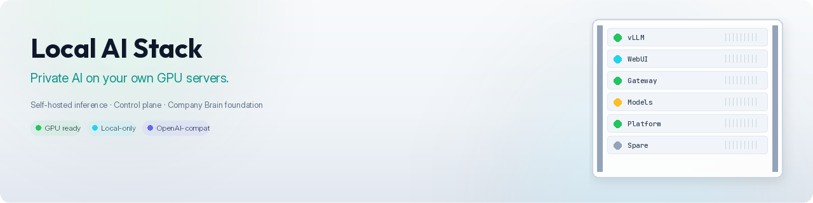

<p align="center"></p>

[](LICENSE)
[](https://www.python.org/)
[](https://github.com/vllm-project/vllm)
[](https://www.docker.com/)

# Local AI Stack

**End-to-end private AI on idle GPUs you already have, or on one server you buy.**

Local AI Stack turns a Linux GPU host you control into a complete private AI path: discover models, check capacity, run inference (vLLM), open a chat UI (Open WebUI), put an OpenAI-compatible gateway in front, keep usage analytics local, and operate it all from a CLI and HTTP Platform API. It is an assembled stack (control plane plus replaceable adapters), not a single chat app.

### Why

- **Cloud inference becomes a permanent bill.** Once pilots move to usage-based pricing, inference turns into the main line item ([VentureBeat, May 2026](https://venturebeat.com/infrastructure/5-gpu-utilization-the-401-billion-ai-infrastructure-problem-enterprises-cant-keep-ignoring)).
- **A lot of GPU capacity already bought sits idle.** The same VentureBeat piece reports average enterprise GPU utilisation of around 5% in the audits it cites. Google notes that idle provisioned machines are part of the real footprint of AI inference ([Google Cloud, Aug 2025](https://cloud.google.com/blog/products/infrastructure/measuring-the-environmental-impact-of-ai-inference/)).
- **New AI data centres are slow and contested.** Local opposition over water, energy, noise and power prices has blocked or delayed many projects ([Forbes, Jul 2026](https://www.forbes.com/sites/robertszczerba/2026/07/22/130-billion-in-ai-data-centers-stalled-the-bottleneck-is-consent/); on water use see [IEEE Spectrum, Sep 2025](https://spectrum.ieee.org/ai-water-usage)).

For many workloads there is a simpler option: use the GPU server you already have, or buy one dedicated box, and run the stack there. These figures describe the market, not measurements of this project.

**Privacy:** traffic stays on infrastructure you control: a machine you own, a colo you rent, or a single rented GPU host. That is your tenancy, not "no provider ever".

> **Status:** Early open-source release ([v0.1.0](https://github.com/dlealvilla/local-ai-stack/releases)). The path that works today is **Linux + NVIDIA + vLLM**. Prototypes and vertical slices through Phase 8+ capacity / resource work are implemented; many settings remain provisional (see [`docs/PROVISIONAL.md`](docs/PROVISIONAL.md) and [`docs/ROADMAP.md`](docs/ROADMAP.md)). Not a finished commercial appliance.

**Design demo (mock UI only):** [local-ai-stack-demo.vercel.app](https://local-ai-stack-demo.vercel.app) uses sample data and is not connected to a model or GPU. The real stack runs on your own GPU host.

Want to help without a GPU? See **[Contribute without a GPU](CONTRIBUTING.md#contribute-without-a-gpu)**. Unit tests (`python3 -m unittest discover -s tests -v`) and many issues need only Python 3.12+.

### What you get today vs planned

| Area | Today | Planned |
| --- | --- | --- |
| Hardware | NVIDIA reference path (`nvidia-smi`) | Additive AMD / ROCm adapters, NVIDIA stays ([#31](https://github.com/dlealvilla/local-ai-stack/issues/31)) |
| Inference | vLLM (process or Docker executor) | Wider inference adapters, e.g. Ollama-compatible sources (vision only, not shipped) |
| Chat UI | Open WebUI, routed through the gateway | LibreChat as an alternative frontend ([#26](https://github.com/dlealvilla/local-ai-stack/issues/26)) |
| Gateway | Builtin OpenAI-compatible proxy | External API routing (roadmap) |
| Models | Local files + Hugging Face | |
| Ops | `./ai` CLI, Platform API, local usage analytics | First-party admin UI (roadmap; the demo is mock only) |

### Longer-term direction

Local AI Stack is meant to be the **private compute layer** of a company brain: where models run, on hardware you control. The other half, the **knowledge layer** that decides what AI is allowed to see, is separate work in [Ankla](https://ankla.io). There is no Ankla integration in this repository today. More background: [`docs/PRODUCT_VISION.md`](docs/PRODUCT_VISION.md) and planning docs in [docs/planning](docs/planning/).

---

## Features

- **Hardware awareness** — Linux host introspection (CPU, RAM, NVIDIA GPU / VRAM via `nvidia-smi`)
- **Model catalog & inventory** — local filesystem discovery; Hugging Face catalog source; download / update into local inventory
- **Capacity planner** — storage and memory feasibility checks before you commit workloads
- **Replaceable adapters** — inference (default **vLLM**), frontend (default **Open WebUI**), gateway (builtin OpenAI-compatible proxy or direct), executors (process / Docker)
- **Lifecycle CLI** — `./ai prepare`, start / stop / restart, status, health, logs, acceptance `./ai test`
- **Platform API (control plane)** — read state, hardware, models, deployment; restart; catalog / inventory / analytics endpoints
- **AI Gateway (data plane)** — OpenAI-compatible proxy with usage events and analytics summary
- **Usage analytics** — partitioned local JSONL events, retention policy, summary by model / provider / day
- **Config** — TOML defaults (`config/defaults.toml`) with auto/manual performance knobs (context length, GPU util, concurrency)

---

## Stack

| Layer | Technology |
| --- | --- |
| Language | Python 3.12+ |
| Control plane | Built-in `platform_api` (ThreadingHTTPServer; provisional) |
| Inference (default) | vLLM (process or Docker executor) |
| Chat UI (default) | Open WebUI |
| Chat UI (optional) | LibreChat (`provider = "librechat"` under `[frontend]`) |
| Gateway (default) | Builtin OpenAI-compatible proxy |
| Model sources | Local files, Hugging Face Hub API |
| Analytics store | Partitioned JSONL under the data root |
| Packaging | CLI entry `./ai`, optional Docker network for multi-service deploy |
| Docs | `docs/PRODUCT_VISION.md`, `ROADMAP.md`, `PROVISIONAL.md` |

---

## Architecture

```
Administrator / automation
        │
        ▼
   CLI (./ai)  ◄──────────────►  Platform API  (control plane)
        │                              │
        ▼                              ▼
   core/control + adapters     normalized Platform State
        │
        ├── Inference (vLLM …)
        ├── Frontend  (Open WebUI …)
        └── Gateway   (builtin proxy → inference)
                │
                ▼
         UsageEvent → UsageStore → Analytics API
```

Core stays provider-agnostic. Adapters under `adapters/` implement inference, frontend, gateway, model sources, and executors. Desired vs observed vs health stay separate in platform state.

Default bootstrap binds services to loopback (`127.0.0.1`); public exposure is never implicit.

---

## Setup

1. Clone this repository onto a **Linux** host with NVIDIA GPU drivers (Docker + NVIDIA Container Toolkit optional; default executor is native **process**).
2. Ensure **Python 3.12+** is available for the CLI / Platform API.
3. Review `config/defaults.toml` (data root, model selection, executor, performance profile, bind addresses).
4. Place or download model artifacts under your configured models / data path.
5. Run `./ai prepare` to create managed runtimes when using the native path.
6. `./ai start` — brings up inference, frontend, gateway, and Platform API per the deployment manifest.
7. `./ai test` — runs the vertical-slice acceptance checks.
8. Point a browser at the local frontend bind address (default `127.0.0.1:3000`), or clients at the gateway’s OpenAI-compatible base URL.

Useful commands: `./ai inspect`, `plan`, `status`, `health`, `state`, `logs`, `stop`, `restart`, `models`, `config`.

Exact ports and data roots are environment- and config-specific; prefer loopback until you deliberately place a reverse proxy in front.

---

## Environment variables (names only)

See also [`.env.example`](.env.example). Prefer a secret manager in production; never commit real values.

| Name | Purpose |
| --- | --- |
| `AI_DATA_ROOT` | Persistent data root (models, analytics, Open WebUI data); defaults.toml also sets `data_root` |
| `HF_TOKEN` | Optional Hugging Face credential for gated / higher-rate Hub access |
| `RUNPOD_ACCOUNT_API_KEY` | Optional; RunPod Network Volume capacity adapter |
| `RUNPOD_VOLUME_ID` | Optional; RunPod volume id for capacity observation |
| `SENTRY_DSN` | Optional; only if you wire error reporting (not required by core) |

Additional service-specific variables may appear in Docker or Open WebUI images.

---

## Project structure

```
local-ai-stack/
├── ai                    # CLI entry
├── config/defaults.toml  # Default platform configuration
├── core/                 # Control plane, state, analytics, capacity, models
├── adapters/             # Inference, frontend, gateway, executor, model sources, …
├── platform_api/         # HTTP control-plane server
├── gateway_service/      # Builtin gateway process
├── docs/                 # Vision, roadmap, provisional register
├── tests/
└── .env.example
```

The remote has many experiment / checkpoint / phase branches (~97). The **default branch (`main`)** is the source of truth for this README.

---

## Screenshots

Self-hosted CLI / Platform API screenshots are not bundled yet. The [design demo](https://local-ai-stack-demo.vercel.app) shows the planned UI with mock data.

---

## Project status

Active R&D / early open release candidate. Read `docs/ROADMAP.md` for completed phases and `docs/PROVISIONAL.md` for known shortcuts.

---

## More from Daniel

- Children’s learning app (live): [https://askwuai.com](https://askwuai.com) — source: [ask-wuai](https://github.com/dlealvilla/ask-wuai)
- Public LMS writing prototype (source): [wildmind-ai-for-education](https://github.com/dlealvilla/wildmind-ai-for-education)

---

## License

This project is licensed under the [MIT License](LICENSE).
