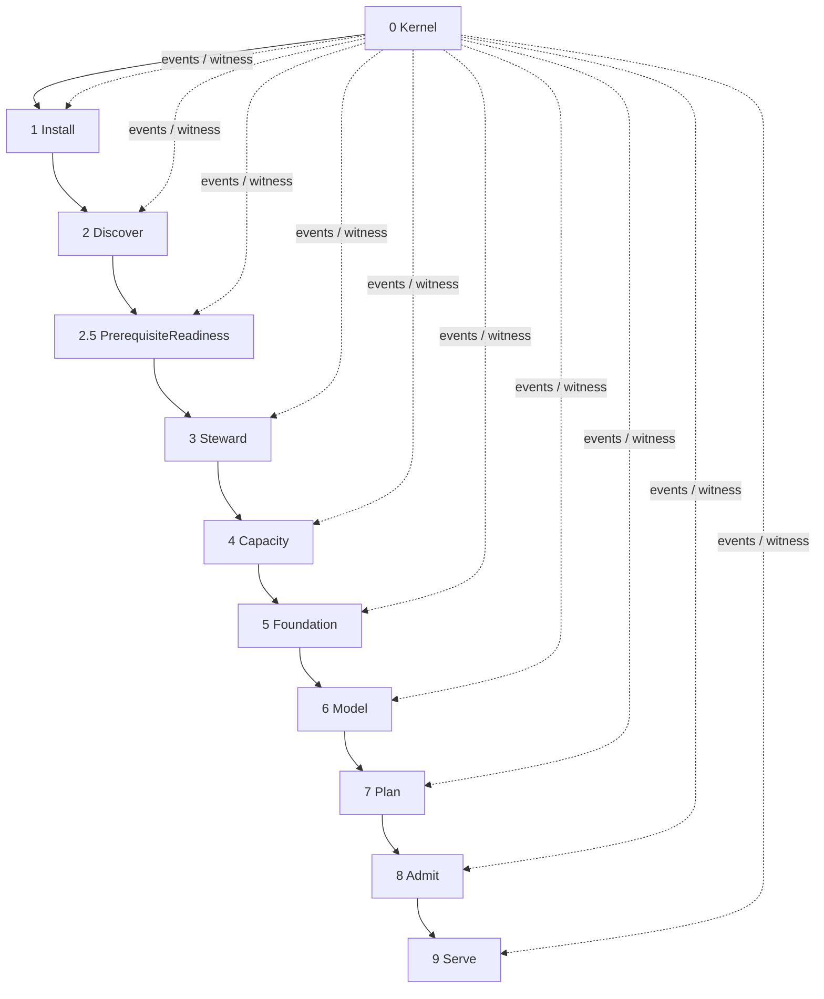
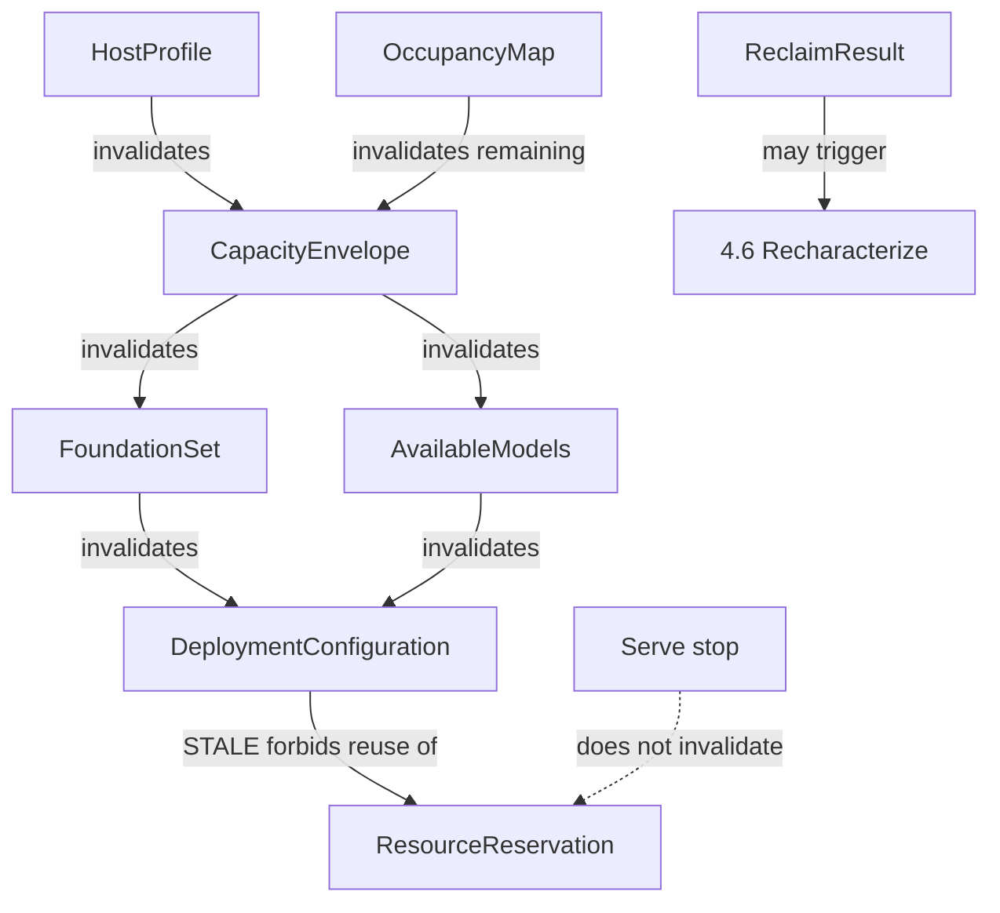
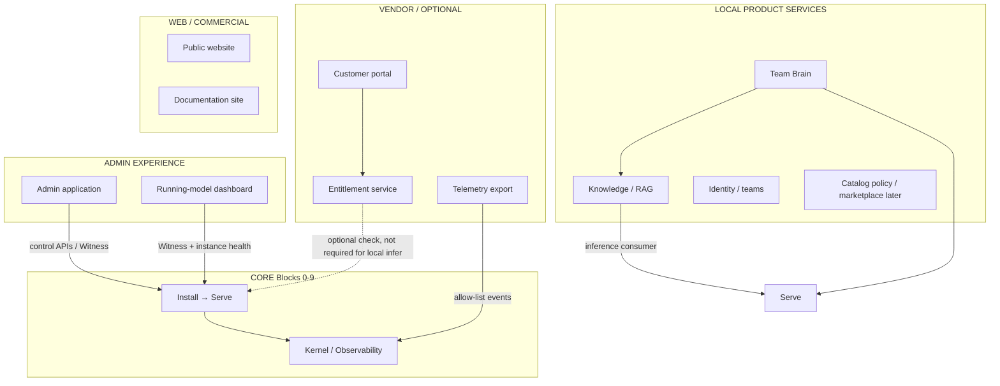

# Machi architecture

**Work token:** `MACHI-0.0.1-ARCHITECTURE`  
**Authority:** Machi product architecture and core sequencing.  
**Kultrun remains:** evidence. Its constitution, module map, and
roadmap are not Machi authorities.

This document is the architecture we would have written **before the
first line of code**, knowing what Kultrun taught.

Entry: [README.md](README.md). Evidence: [KULTRUN.md](KULTRUN.md).
Contracts: [CONTRACTS.md](CONTRACTS.md). Observability:
[TELEMETRY.md](TELEMETRY.md). Build order: [ROADMAP.md](ROADMAP.md).

---

# 1. Mission and scope

Machi installs onto existing compute and produces a **governed,
resource-admitted, locally verified model service**.

The core product is not a chatbot, not Docker, not a capacity
spreadsheet, and not an Admin dashboard. Those may attach later.

**Core boundary:** from invoking a Machi artifact on a supported host
through a **request** inference that proves the selected model, with
durable configuration, reservation, events, and a witness that can
explain the journey without logs.

**Out of core (attach later):** Knowledge/RAG, teams, Team Brain,
marketplace UX, licensing backends, public website, fleet,
optimization products, and the hosted Runtime Artifact Registry / software
supply-chain service. Machi core may consume exact artifact identities,
recipes, provenance and local staging contracts; the future registry is a
delivery provider, not a local control-plane authority and not the Model
Warehouse.

**In core from day one:** observability (events, provenance, local
metrics spine). Not the warehouse. Not the dashboard.

---

# 2. Clean-slate principle

Machi is implemented from scratch.

It is not a rename, a package move, or a duty to preserve Kultrun
module files. KEEP in the traceability table means **the invariant and
the lesson**.

---

# 3. Relationship to Kultrun

Kultrun (this repository, `src/kultrun/`) proved that a walking
skeleton on real NVIDIA hardware is possible, and that storage,
ownership, leftover installs, and honest reporting are part of that
skeleton — not polish.

Kultrun also showed that **too many separately shipped stages** make
the primary flow unreadable, and that a report which live-re-resolves
capacity after install will lie.

Machi keeps the proven invariants, collapses the stage sprawl into
**nine Blocks plus Kernel**, and makes events first-class.

---

# 4. Architectural principle (plain language)

Machi is a **short, testable pipeline** that answers, in order:

1. Who are we on this disk?
2. What does this machine appear to contain?
3. What leftover Machi-owned bytes should we keep or delete?
4. What may we safely consume?
5. How will we run software, and did we actually install it?
6. Which model is allowed, chosen, and present locally?
7. What exact configuration will we run?
8. May we run it **now**?
9. Did a real request get a real answer?

Under that pipeline, changing an earlier answer **invalidates** later
ones. It does not silently rewrite them. A ResourceManager is the
only thing that may say yes to step 8. Docker is an adapter, never
the product.

---

## 4.1 Core-vs-commodity implementation rule

Machi must distinguish **owned semantics** from **implementation mechanics**.

For mechanics outside Machi's differentiating core, research the current
industry practice before designing code. Prefer, in order, an established
standard, a mature library/project, a replaceable adapter around an external
implementation, or a small bounded implementation. Do not invent a subsystem
because the repository happens not to contain one yet.

For enabling infrastructure, keep the generic Machi contract and provider
boundary while integrating mature implementations where they fit.

For core concepts—host/capacity truth, resource authorization, deployment
identity, qualification meaning, Plan/Serve invariants, evidence/witness
semantics, and other product-defining control decisions—Machi owns the contract
even when libraries or runtimes implement lower-level mechanics.

### Product Vision Alignment Gate

Every material architecture/provider/build-vs-integrate decision must be checked
against the authoritative Product Vision before implementation.

For each viable option record:
- `ALIGNED`, `ALIGNED_WITH_CONDITIONS`, or `MISALIGNED`;
- the exact Product Vision principles affected;
- any effect on self-hosting, privacy, offline/air-gap, replaceability,
  provider-neutral contracts, ownership, safety, evidence, administrator
  simplicity, enterprise governance, commercial/licensing direction, and future
  Company Brain capabilities;
- whether any tension is temporary, adapter-contained, or structurally changes
  the product.

A technically superior option may still be rejected if it is structurally
misaligned with the product. A MISALIGNED choice requires explicit Lead/product
approval to revise the Product Vision; it is not an engineering default.

### Industry Solution Selection Gate

Before code changes, stop for Lead/product decision when:
- two or more credible standards/libraries/projects remain materially viable;
- the choice introduces meaningful lock-in or affects security, privacy,
  licensing, redistribution, portability, deployment model, supportability, or
  commercial strategy;
- the choice changes a Machi/Kultrun-owned contract or control boundary;
- the choice is build-vs-integrate near the product core.

The decision package must identify the generic capability, viable alternatives,
evidence, trade-offs, recommended default, reversibility/migration cost, and
whether each option can be deferred. Do not silently choose.

If no meaningful choice exists, explicitly state **"No solution decision
required"** and proceed. The existing Provider Selection Gate remains required
for provider-specific implementation and is a specialization of this gate.

---

# 5. Hierarchy

| Level | Official name | ID shape | Meaning |
|---|---|---|---|
| 1 | **Block** | `1` | Independently shippable building block of the installation-to-inference spine. Has one primary output contract. Roadmap milestone maps 1:1 (M1 implements Block 1, …). |
| 2 | **Capability** | `1.1` | A major responsibility inside a Block. Still a named contract or gate. |
| 3 | **Component** | `1.1.1` | A contained service, port, or adapter. Not a separately shipped product. |

**Block 0 Kernel** is reserved (`0.x`). It is governance and
observability, not a customer-visible deployment step, but it is
implemented first (milestone M0).

There is no Level 4. If a Component needs an internal helper, it is
not an architecture ID.

Work identifiers: `MACHI 1.1.1` means Block 1, Capability 1, Component 1.

---

# 6. Deployment start and completion

**Deployment begins when** a Machi artifact is invoked on a host and
Kernel can persist events. The first *domain* Block is **Install**:
bind a state root, mint `InstallRun`, claim ownership of that tree.
Host discovery is second, because Machi cannot persist or reclaim
honestly without knowing who it is.

**Deployment succeeds when** all of the following are true:

- `DeploymentConfiguration` is CURRENT and persisted;
- `ResourceReservation` is ADMITTED and held;
- `RuntimeCapability` is VERIFIED;
- `ModelArtifact` is local and matches the selection;
- `ReadinessProof` succeeded (not counted as user inference);
- `InferenceProof` with `purpose=request` is PASS and the served
  model identity matches the selection;
- Event journal contains the chain with one `InstallRun`;
- `DeploymentWitness` can be composed from stored contracts + events
  without live re-resolution.

The serving process may be **stopped**. Success does not require it to
still be running. Reservation remains until explicit release.

---

# 7. Diagram B — core flow



Recompute (not a second pipeline) is Diagram E.

---

# 8. Diagram C — hierarchy (shape)

```text
0 Kernel
  0.1 Contracts
      0.1.1 Registry
      0.1.2 Unresolved
  0.2 Record identity
      0.2.1 Typed IDs
  0.3 Events
      0.3.1 EventRecord
      0.3.2 Journal
      0.3.3 Observers
  0.4 Persistence
      0.4.1 Store port
  0.5 Privacy
      0.5.1 Classification
  0.6 Witness
      0.6.1 DeploymentWitness
  0.7 Health
      0.7.1 Aggregator
1 Install
  1.1 Install identity
      1.1.1 InstallRecord
  1.2 State root
      1.2.1 StateRootBinder
  1.3 Self-ownership
      1.3.1 SelfOwnershipMarker
      1.3.2 RegistrySeed
  1.4 InstallRun
      1.4.1 InstallRunStore
2 Discover
  2.1 Environment
  2.2 CPU / RAM
  2.3 Accelerator Discovery
  2.4 Mounts
  2.5 PrerequisiteReadiness
3 Steward
  3.1 Ownership
  3.2 Occupancy
  3.3 Reclaim
4 Capacity
  4.1 Pool identity
  4.2 Characterization
  4.3 Envelope
  4.4 Remaining
  4.5 Host minimum
  4.6 Recharacterize
5 Foundation
  5.1 Executors
  5.2 Runtime catalogue
  5.3 Resolve
  5.4 Provision
  5.5 Verify
  5.6 Select
6 Model
  6.1 Explicit sources
  6.2 Compatibility
  6.3 Requirement
  6.4 Select
  6.5 Warehouse
7 Plan
  7.1 Compose
  7.2 CURRENT / STALE
  7.3 Recipe
8 Admit
  8.1 Snapshot
  8.2 ResourceManager
  8.3 Reservation lifecycle
9 Serve
  9.1 Instance
  9.2 Execute
  9.3 Readiness
  9.4 Request inference
  9.5 Reconcile
  9.6 Usage emission
```

---

# 9. Top-level architecture table

| ID | Block | Purpose | Capabilities | Adapters | Primary input | Primary output | Primary telemetry |
|---|---|---|---|---|---|---|---|
| 0 | Kernel | Mechanisms, events, witness | 0.1–0.7 | store, disabled export | none | EventRecord, Witness | `kernel.alive` |
| 1 | Install | This copy on this disk | 1.1–1.4 | none at v0 | artifact | `StateRootBinding` (1.2.1); `LocalOwnershipEstablishment` (1.3.1; not dual proof); later InstallRecord, InstallRun, registry (1.3.2) | `install.state_root.bound` (1.2.1); `install.ownership.local_marked` (1.3.1); `install.bound` (1.4.1) |
| 2 | Discover | Observe the machine | 2.1–2.4 | OS/arch, memory, NVIDIA/AMD/Apple accelerators, Linux/macOS mounts | InstallRecord | HostProfile | `discover.completed` |
| 2.5 | PrerequisiteReadiness | Are selected environment prerequisites usable? | 2.5.1 | vendor-CLI adapters (first: AMD `amd-smi`) | policy + host environment | `PrerequisiteReadinessReport` | `prerequisite.*` |
| 3 | Steward | Own, classify, reclaim | 3.1–3.3 | filesystem markers | HostProfile | OccupancyMap, ReclaimResult | `steward.*` |
| 4 | Capacity | What may be consumed | 4.1–4.6 | posix, fuse, quota, sonar writer | OccupancyMap | CapacityEnvelope, HostMinimumVerdict | `capacity.*` |
| 5 | Foundation | How software will run | 5.1–5.6 | native process, container, vLLM provision | Envelope | FoundationSelection, RuntimeCapability | `foundation.*` |
| 6 | Model | What weights to serve | 6.1–6.5 | Hub/fixture acquire | RuntimeCapability | ModelSelection, ModelArtifact | `model.*` |
| 7 | Plan | Authoritative configuration | 7.1–7.3 | none | selections + artifacts | DeploymentConfiguration | `plan.*` |
| 8 | Admit | Authorize now | 8.1–8.3 | none (policy core) | Configuration | ResourceReservation | `admit.*` |
| 9 | Serve | Run and prove a request | 9.1–9.6 | native process, vLLM runtime | Reservation + Configuration | InferenceProof | `serve.*` `inference.completed` |

`2.5` is a Block 2 capability, not a tenth Block. Discover (`2.1`–`2.4`)
remains read-only observation. PrerequisiteReadiness may mutate only
explicitly allowlisted environment prerequisites under policy.

---

# 10. Why this sequence

**Install is first** because persistence, ownership, and correlation
need a root. Kultrun put `install` in tier 9 (component apt). The
product-install of Machi itself is a different concept and empirically
happens before `kultrun host`.

**Discover is second** because Steward and Capacity need mounts and
accelerators, and must not invent them.

**Steward is before Capacity** because leftover owned bytes change
remaining, and because cleanup is lifecycle, not a capacity hack.
Kultrun learned this on a host with sibling trees: UNKNOWN parents hid
RECLAIMABLE children; accounted usage ignored siblings; Sonar had to
run again after delete.

**Capacity before Foundation** because pip/runtime peaks are
admitted against SAFE remaining, not `df`.

**Foundation before Model** because Available Models are
runtime-specific. Estimated-feasible is not available until
calibration/capability exists.

**Plan before Admit** because execution must derive from a consistent
configuration. Admission without a plan is a queue. Kultrun
`planning ⟂ resource` is preserved: Plan does not authorize.

**Admit before Serve** because executors must never decide.

**Serve last** because it is the only Block that must talk to a real
model. Witness is Kernel 0.6, updated continuously, accepted at M9.

**Graph under the sequence:** after reclaim, Capacity 4.6 may
re-enter characterization. Changing ModelSelection invalidates Plan
(STALE) and requires re-admit. Stop does not re-enter Admit.

This is simpler than Kultrun because the **user-visible spine is nine
Blocks**, not 1.1…1.6L4b, while Capabilities still protect concept
ownership.

---

# 11. Block definitions

Each Block below is the required top-level definition.

## 0 Kernel

**ID:** 0  
**Name:** Kernel  
**High-Level Purpose:** Mechanisms every Block shares; no machine
policy.  
**Short Description:** Contracts, Unresolved, IDs, event journal,
persistence port, privacy, witness projection, health aggregation.

**Major Components:** 0.1 Contracts, 0.2 IDs, 0.3 Events, 0.4 Store,
0.5 Privacy, 0.6 Witness, 0.7 Health.

**Approved Kernel increment (0.4.1, accepted):**

| ID | Name | Role | Status |
|---|---|---|---|
| `0.4.1` | Store | Persist/retrieve versioned entity contracts by caller-owned key | accepted |

`Store` is a Kernel port. The filesystem adapter is `FileStore` under
`adapters/persistence`. The journal remains a separate port. Store is
not event-sourced, does not choose its root, and does not implement
RegistrySeed. A registered older contract version is upgraded when it
is read. FileStore first records a migration intent, then replaces
that one record, then marks the receipt complete. Those are separate
files. A crash leaves the intent visible until a later read finishes
the receipt. A complete receipt is not written before the current
record is on disk, and a complete receipt does not upgrade a record
that is still historical. The journal line is left as appended.
Unknown kinds and versions fail closed. The path landed after the
first schema bumps; that timing is recorded on `K-03`.

**Adapters:** persistence filesystem; disabled telemetry export.

**Inputs:** none.  
**Outputs:** EventRecord, DeploymentWitness, health document.  
**Preconditions:** artifact present.  
**Success:** events persist and round-trip.  
**Failure / Blocked:** store unwritable → FAIL, do not invent success.  
**State owned:** none of the machine; owns mechanisms.  
**Persistence:** journal + store port.  
**Side effects:** files under state root after Install exists.  
**Downstream:** every Block.  
**Re-entry:** `kernel.alive` may be invoked again; each invocation
appends a **new** EventRecord with a new `event_id`. That is journal
append, not a singleton and not operational state.  
**Idempotence:** event IDs unique; composing Witness (later) is pure.  
**Invalidated by:** nothing domain-level.  
**Recompute:** Witness always derived.  
**Analytics / Telemetry:** owns the envelope.  
**Independent test:** T0 + T2 identity.  
**Cumulative test:** M0.  
**Kultrun lessons:** Unresolved; unused `kernel.Event` vs live
OperationalFact — merge; report must not live-re-resolve.

## 1 Install

**ID:** 1  
**Name:** Install  
**Purpose:** Bind this Machi copy to a disk tree and a correlation
identity.  
**Short Description:** Artifact identity, state root, self ownership,
InstallRun.

**Approved Components (M1):**

| ID | Name | Role | Status |
|---|---|---|---|
| `1.2.1` | StateRootBinder | Resolve, normalize, establish the filesystem root | accepted |
| `1.3.1` | SelfOwnershipMarker | Local ownership evidence for this bound root (`LOCAL_MARKER_PRESENT`) | accepted |
| `1.3.2` | RegistrySeed | Local control-plane registry half; cites 1.3.1; not dual-proof evaluation | accepted |
| `1.1.1` | InstallRecord | Stable installation identity; create-once InstallId; creation-build provenance | accepted |
| `1.4.1` | InstallRunStore | Mint/reuse InstallRun; complete Install correlation | accepted |

Working implementation order: `1.2.1` → `1.3.1` → `1.3.2` → `1.1.1` → `1.4.1`.
Location before local evidence before central registry before install identity
before correlation. Wheel `BUILD.json` remains Kernel (M0); `1.1.1` is not
“identity in the wheel”.

**Dual ownership is two authorities, not one file.**

The ownership registry is the **local customer Machi control plane**.
It is not a vendor cloud, website, or subscription service. Machi
ownership must keep working offline. Future fleet/vendor systems may
consume permitted metadata later; they are not the primary authority
for local resources.

- `1.3.1` proves: a valid Machi local marker exists for this bound state root.
- `1.3.1` does **not** prove dual ownership, Install identity, or cleanup rights.
- `1.3.2` persists the matching **local control-plane** registry record that cites the same
  local evidence identity (`marker_id`) and root fingerprint. Registry Store location is
  injected; it is not hard-coded inside the claimed root.
- `1.3.2` still does **not** evaluate dual proof and does **not** authorize destruction.
- Steward `3.1 OwnershipRecord` is later dual-proof evaluation. Do not reuse
  that name for the 1.3.1 local marker or the 1.3.2 registry row.
- `1.1.1` persists a create-once `InstallRecord` keyed by `marker_id`, minting
  one `InstallId`. Build identity on that record is **creation provenance**,
  not current software version. A later compatible build re-enters the
  same InstallId. `install_run_id` and `host_id` stay unresolved.
- `1.1.1` still does **not** evaluate dual proof and does **not** authorize
  destruction. It does not mint InstallRun.
- `1.4.1` persists a create-once `InstallRunRecord` keyed by `InstallId`,
  minting one `InstallRunId` per installation. A later process or compatible
  build re-enters the same run. `host_id` stays unresolved. This is not a
  process, CLI invocation, or host identity, and it is not run history.
- `1.3.2` consumes Kernel `0.4.1` entity Store (Kernel increment; not an Install port).

**Adapters:** none v0 (later: OS package helper is Foundation, not
this).

**Inputs:** invocation, optional `--state-root`, optional `MACHI_STATE_ROOT`.
`1.3.1` consumes `StateRootBinding`; it does not re-resolve the root.
**Outputs:** `StateRootBinding` (1.2.1); `LocalOwnershipEstablishment` (1.3.1);
`LocalOwnershipRegistryRecord` (1.3.2); `InstallRecord` (1.1.1);
`InstallRunRecord` (1.4.1).
Not `OwnershipRecord`.
**Preconditions:** Kernel journal port (directory injected; Kernel does not choose the root).
**Success (1.2.1):** directory exists; `StateRootBinding` returned; `install.state_root.bound` journaled.
**Success (1.3.1):** `.machi-owner.json` created or validated for this fingerprint;
status `local_marker_present`; `dual_ownership=false`; `destructive_authorization=false`;
`install.ownership.local_marked` journaled.
**Success (1.3.2):** injected Store holds a `LocalOwnershipRegistryRecord` citing
the same `marker_id` and root fingerprint; status `registry_seed_present`;
`dual_ownership=false`; `destructive_authorization=false`;
`install.ownership.registry_seeded` journaled.
**Success (1.1.1):** injected Store holds an `InstallRecord` for the same
`marker_id` and root fingerprint; one `InstallId`; status `install_record_present`;
`dual_ownership=false`; `destructive_authorization=false`;
`install.record.established` journaled with resolved `install_id`.
**Success (1.4.1):** injected Store holds an `InstallRunRecord` keyed by
`InstallId`; one `InstallRunId`; status `install_run_present`;
`dual_ownership=false`; `destructive_authorization=false`;
`install.bound` journaled with resolved `install_id` and `install_run_id`;
`host_id` remains unresolved.
**Blocked:** cannot create or write the root; file at path; Kultrun-owned tree;
malformed or conflicting Machi marker; unknown pre-existing content (1.3.1).
**Blocked (1.3.2):** binding and marker disagree; malformed or conflicting registry
row; Store unwritable.
**Blocked (1.4.1):** missing/invalid InstallRecord; malformed or conflicting
InstallRun; Store unwritable. Copied roots never reach 1.4.1.
**State owned (1.2.1):** none beyond the directory itself. Binding is not ownership.
**State owned (1.3.1):** local marker file only. Not the tree as dual-owned property.
**Persistence:** directory create; `.machi-owner.json`; event via Kernel journal under `<root>/journal` unless injected.
**Side effects (1.2.1):** create the bound directory only. No owner marker, no models/runtimes, no sibling scan.
**Side effects (1.3.1):** exclusive create or validate `.machi-owner.json`. Never overwrite, reclaim, or scan siblings.
**Side effects (1.3.2):** exclusive create or validate a registry row in the injected
Store. Never overwrite, reclaim, or write into the claimed state root.
**Side effects (1.1.1):** exclusive create or validate an InstallRecord in the
injected Store (typically the same control-plane Store as 1.3.2, different
kind). Never overwrite, mint InstallRun, or couple identity to a host.
**Side effects (1.4.1):** exclusive create or validate an InstallRunRecord in
the injected Store (same control-plane Store, different kind). Never
overwrite, mint HostId, or rotate a new run per CLI process.
**Downstream:** 1.4.1, then all later Blocks.
**Re-entry (1.2.1):** bind the same valid root again; `existed=true`, `created=false`; append another event.
**Re-entry (1.3.1):** return the same `marker_id` and `created_at`; do not rewrite the file.
**Re-entry (1.3.2):** return the same `marker_id` and `created_at`; do not rewrite the row.
**Re-entry (1.1.1):** return the same `InstallId` and `created_at`; do not rewrite
the row; a different invoking build is not a conflict.
**Re-entry (1.4.1):** return the same `InstallRunId` and `created_at`; do not
rewrite the row; a different invoking build is not a conflict.
**Idempotence:** second bind does not recreate structure. Marker, registry,
InstallId, and InstallRunId are stable.
**Invalidated by:** moving the tree without markers (conflict; copied marker fails closed).
**Recompute:** none.
**Telemetry:** `install.state_root.bound`, `install.ownership.local_marked`,
`install.ownership.registry_seeded`, `install.record.established`, and
`install.bound` (privacy `restricted`; path omitted). The 1.1.1 event carries
a resolved `InstallId` and leaves `install_run_id` unresolved. The 1.4.1
event resolves both `InstallId` and `InstallRunId`; `host_id` stays
unresolved. Earlier events are not rewritten.
Never emit `ownership.verified` from 1.3.1, 1.3.2, 1.1.1, or 1.4.1.
**Independent test:** two roots isolated in one registry, one InstallId and
one InstallRunId each; copied root refused; mismatch fail-closed; later
build re-enters the same InstallId and InstallRunId; concurrent first
create converges on one run; injected Store not inside the claimed root.
**Cumulative:** M0→1.2.1→1.3.1→0.4.1→1.3.2→1.1.1→1.4.1.
**Lessons:** Kultrun K-20 (cwd-relative default, blank env ≠ `/`); default-root warning on artifacts; install≠apt; do not claim `.kultrun-owner.json` trees; do not treat malformed marker JSON as absence; do not store absolute paths on the marker.

## 2 Discover

**ID:** 2  
**Name:** Discover  
**Purpose:** Observe the machine. Never authorize.  
**Short Description:** OS, CPU, RAM, accelerators, mounts, with
provenance.

**Approved Components (M2 start):**

| ID | Name | Role | Status |
|---|---|---|---|
| `2.1.1` | OS/arch adapter | Observe OS family and CPU architecture through a replaceable adapter | accepted |
| `2.2.1` | Memory observer | Observe reported physical/system memory in bytes | accepted |
| `2.3` | Accelerator Discovery | Generic accelerator observation capability | NVIDIA+AMD implemented locally; physical pending for this candidate |
| `2.3.1` | Native accelerator observer | Generic port + provider orchestration | NVIDIA, AMD, retained Apple; Intel out |
| `2.4.1` | Mount enumerator | Filesystem/mount topology | accepted (Darwin + Docker overlay physical) |

Working implementation order: `2.1.1` → `2.2.1` → `2.3` (generic +
NVIDIA and AMD accepted providers; Apple retained) → `2.5.1` →
`2.4.1`. OS/arch before memory before accelerators before mounts.
HostProfile aggregation waits until enough observations exist. `2.3` is the generic accelerator
capability. `2.3.1` is the native observer (orchestration), matching
`2.2.1`. NVIDIA, AMD, and Apple are providers under it, not the
capability model. Intel remains unimplemented.

- `2.1.1` (accepted) observes OS family and CPU architecture. Core owns
  `OSArchitectureObservation`. The native adapter owns `platform.system`
  / `platform.machine`.
- `2.2.1` (accepted) observes reported physical/system memory in
  integer bytes. Core owns `MemoryObservation`. The native observer
  selects a Linux or macOS memory provider. Windows is unsupported, not
  zero. This is not safe allocatable memory.
- `2.3` / `2.3.1` observes accelerator devices through a vendor-neutral
  contract. Core owns `AcceleratorObservation`. The native observer
  selects applicable NVIDIA, AMD, and Apple providers. AMD is Linux-only.
  Historical NVIDIA physical PASS does not qualify a later NVIDIA+AMD
  wheel. Apple physical remains deferred. Intel is unimplemented. This is
  not safe GPU memory.
- `2.4.1` observes filesystem/mount topology through a replaceable
  observer. Core owns `MountObservation`. The native observer selects
  a Linux or macOS provider. Windows is unsupported, not zero. Reported
  total/free/available bytes, a tiny write probe, and SAFE deployable
  capacity remain distinct. Backing identity is recorded when the
  platform exposes it and stays `Unresolved` when it does not.
  Classification is provider-owned and is not a safety label.
  Suitability signals are descriptive, not admission.
- `2.1.1` / `2.2.1` / `2.3` / `2.4.1` do **not** mint HostId, persist
  HostProfile, infer Steward ownership from path names, or compute
  SAFE capacity.
- Unknown is not defaulted. Missing measurements stay unobserved.
  Unknown is never emitted as `0`. Unavailable tooling is not a
  measured empty device list.
- Discover events may carry resolved `install_id` and `install_run_id`
  from composition after M1. `host_id` stays unresolved.
- Observation is not mutation. Adapters must not write `/etc`, change
  swap, tune cgroups, remount, fill a filesystem, or change GPU
  persistence/MIG/power. A tiny exclusive Machi-owned temp write with
  guaranteed cleanup may be used as observational path evidence when
  explicitly enabled; it is not Storage Sonar. Discover must not
  import PrerequisiteReadiness, Steward, or Capacity.

**Adapters:** native OS/arch (accepted); native memory observer with
Linux and macOS providers (accepted); native accelerator observer with
NVIDIA, AMD, and retained Apple providers (NVIDIA+AMD physically
covered on SHA `eaee5c98…`); native mount observer with Linux and
macOS providers (this increment). Intel later. Windows mount reader
later. Adapters observe; they do not decide models. They do not
remediate.

**Inputs:** optional InstallRecord / InstallRun correlation from
composition; Memory and Accelerator compose OS family from 2.1.1 for
applicability. Accelerator does not consume `MemoryObservation`.  
**Outputs (2.3):** `AcceleratorObservation`; event
`discover.accelerator.observed`. HostProfile remains later.  
**Preconditions:** Kernel. OS family from 2.1.1. Install correlation is
required only when composition asks to attach M1 identities.  
**Success (2.3):** typed accelerator observation returned; provider
failures retained; Apple unified topology without fake VRAM; NVIDIA
discrete devices without primary-GPU reduction. NVIDIA physical PASS
on the combined candidate.  
**Blocked (2.3):** Apple Silicon physical proof and Checkpoint A remain
on that same candidate.  
**State owned (2.3):** none. The observation is not durable entity
state.  
**Persistence (2.3):** event only. No Store record.  
**Side effects:** none on the host. Journal append only.  
**Downstream:** later Discover components; Capacity still requires
HostProfile and must not treat accelerator memory as SAFE.  
**Re-entry:** observe again; new observation and event; do not mutate
the previous event.  
**Idempotence:** same host yields the same device identities, topology,
and reported dedicated totals when sources are stable.  
**Telemetry:** `discover.accelerator.observed` (privacy `public_ops`).
Block-complete `discover.completed` remains later.  
**Independent test:** Linux table fixtures; native current-host
observation; M1 + 2.1.1 regression.  
**Cumulative:** M0→M1→2.1.1→2.2.1.  
**Lessons:** reported memory ≠ safe memory; HostId is not RAM size;
cgroup/execution limits remain deferred.

**Deferred:** available memory, swap, cgroup/execution memory limit,
Windows native reader. Reconsider at HostProfile / Capacity, not by
silently treating `MemTotal` as the admission ceiling.

## 2.4 Mounts

**ID:** 2.4  
**Name:** Mounts  
**Purpose:** Observe storage/mount topology visible to this process.
Never authorize. Never compute SAFE storage.  
**Short Description:** mount table, reported capacity, backing
identity, path capability, descriptive candidacy.

**Approved Components:**

| ID | Name | Role | Status |
|---|---|---|---|
| `2.4.1` | Mount enumerator | Observe filesystem/mount topology through a replaceable adapter | accepted (Darwin + Docker overlay physical) |

- Core owns `MountObservation`. Linux and macOS providers classify
  filesystems. Windows is unsupported, not zero.
- Reported `total_bytes`, `free_bytes`, and `available_bytes` stay
  distinct. None of them is proven writable capacity. None is SAFE.
- Backing-store identity is `dev:major:minor` (Linux) or `fsid:a:b`
  (macOS) when the platform exposes a non-zero identifier;
  `Unresolved` otherwise. Overlay is classified overlay; host-backing
  reconciliation is later.
- Native quota specialists are not read. Quota options may be
  advertised-but-unread (`unavailable`). That is not a zero quota.
- Default write probe is off. When enabled, the payload is tiny,
  Machi-owned, exclusive, fsync'd, and deleted. Success means this
  path accepted that payload.
- Discover does not walk customer directories, remount, reclaim, or
  infer ownership from names such as `/models`.
- Typed inspectable settings travel with the observation.
  `MEANINGFUL_SETTINGS_REMAIN_TYPED_AND_INSPECTABLE=YES`.

**Inputs:** optional InstallRecord / InstallRun correlation; OS family
from 2.1.1 for provider selection. Does not consume Steward or
Capacity.  
**Outputs:** `MountObservation`; event `discover.mounts.observed`.  
**State owned:** none.  
**Persistence:** event only.  
**Downstream:** Steward occupancy; Capacity pool identity. Neither
may treat reported free bytes as SAFE.  
**Telemetry:** `discover.mounts.observed` (privacy `operational`).  
See [M2-2.4.1.md](M2-2.4.1.md).

## 2.5 PrerequisiteReadiness

**ID:** 2.5  
**Name:** PrerequisiteReadiness  
**Purpose:** Decide whether software/environment prerequisites required
by a selected provider/runtime/path are usable, and if not, explain and
optionally remediate under policy.  
**Short Description:** inspect → diagnose → plan → policy-gated
remediate → re-inspect → verify.

This is **not** Discover. Discover remains read-only. This is **not**
ResourceManager, Plan, Foundation, a package-management platform, a
driver installer, or an optimizer.

**Approved Components:**

| ID | Name | Role | Status |
|---|---|---|---|
| `2.5.1` | PrerequisiteReadiness | Generic cycle + policy + inspectable settings | accepted |
| `2.5.1` adapter | `AmdSmiPrerequisiteAdapter` | First real adapter: AMD vendor CLI operational | accepted |

**Lifecycle:** inspect → diagnose → plan → if policy permits mutation,
remediate → re-inspect → verify. READY is never claimed from a mutation
without verification. Already-READY is `NO_OP`, not a reinstall.

**Readiness states:** `ready`, `blocked`, `remediable`, `unknown`,
`not_applicable`, `failed`. Unknown is never Ready and never Missing.

**Policy modes:** `observe_only` (inspect/diagnose only), `plan_only`
(product default; inspect/diagnose/plan, never mutate), `remediate`
(allowlisted actions only, then verify).

**May:** install a specific missing interpreter dependency when the
adapter positively proves that is the diagnosed cause, into the
interpreter the target CLI actually uses, in a policy-authorized
environment, recording exactly what changed.

**Must not:** install or replace GPU drivers; modify kernel modules;
install arbitrary ROCm/CUDA stacks; upgrade system Python; mutate Machi
code; modify model/runtime configuration; allocate GPUs; launch
inference; perform unrelated package upgrades; accept an arbitrary
package name from the caller.

**Configuration:** every meaningful setting is a typed
`PrerequisiteSetting` (value, provenance, reason, allowed values,
support state, mutability, invalidation). Selected policy is desired
state; inspection/verification is effective state. Adapters may
translate typed settings into argv, but argv is not the source of
truth. Future administration and optimization consume these contracts,
not raw host flags.

**Adapters:** `AmdSmiPrerequisiteAdapter` (Linux `amd-smi` health). The
first remediable instance is a missing interpreter module (`yaml` →
allowlisted `PyYAML==6.0.2`). Diagnosis is the generic missing-module
class, not a PyYAML special case. PyYAML is a target-environment
prerequisite, not a Machi wheel dependency.

**Inputs:** selected `PrerequisitePolicy`; current host environment;
optional M1 InstallId/InstallRunId from composition.  
**Outputs:** `PrerequisiteReadinessReport` (inspection, diagnosis, plan,
optional remediation/verification, inspectable settings); events
`prerequisite.*`.  
**Preconditions:** Kernel. Composition may attach M1 identities.
Discover observations are not consumed and are not rewritten.  
**Success:** truthful readiness; plan when policy allows; mutation only
when remediating an allowlisted action; post-mutation verification;
idempotent READY → `NO_OP`.  
**Blocked:** missing executable, permission denied, unrecognized
failure, ambiguous interpreter, non-allowlisted module, unavailable
dependency source, policy that forbids mutation.  
**State owned:** none as durable entity state. Reports are results.  
**Persistence:** events only. No Store entity.  
**Side effects:** none under `observe_only` / `plan_only`. Under
`remediate`, only the allowlisted interpreter-dependency command
against the identified CLI interpreter.  
**Downstream:** later adapters that need a usable vendor CLI; never
Capacity or admission.  
**Re-entry:** evaluate again; READY remains `NO_OP`.  
**Idempotence:** second cycle after successful remediation is READY
without mutation.  
**Telemetry:** `prerequisite.inspected`, `prerequisite.diagnosed`,
`prerequisite.plan_created`, `prerequisite.remediation_started`,
`prerequisite.remediation_completed`, `prerequisite.remediation_failed`,
`prerequisite.verified` (privacy `operational`; no paths, no customer
content).  
**Independent test:** fixture host covering READY, missing executable,
missing allowlisted module, unrecognized failure, timeout, permission,
not-applicable, policy modes, interpreter identity, forged package
refusal, offline source representation, round-trip, event privacy.  
**Cumulative:** M0→M1→2.1.1→2.2.1→2.3→2.5.1.  
**Lessons:** vendor CLI presence ≠ vendor CLI usability; target
interpreter ≠ Machi interpreter; network install is a represented
source, not the architecture.

**Deferred (Tier 3):** privileged driver installation; multiple
remediation strategies; rollback; dependency graphs; managed offline
artifact cache; CUDA/ROCm full prerequisite preparation;
cross-platform package-manager abstraction; organization policy
templates.

## 3 Steward

**ID:** 3  
**Name:** Steward  
**Purpose:** Know which known roots Machi owns, how they are protected,
and what occupancy Capacity may later account for.  
**Short Description:** Dual-proof ownership, lifecycle, protection,
occupancy, reclaimability. Tier 2 does not delete.

**Components:** 3.1 Ownership, 3.2 Occupancy, 3.3 Reclaimability.
The Tier-3 delete executor is not this increment.

**Adapters:** read the local marker and the Install registry; measure
a verified root without following symlink escapes. No path-name
ownership and no mount crawl.

**Inputs:** caller-supplied roots, Install marker and registry, optional
`MountObservation` already produced by 2.4.  
**Outputs:** `OccupancyMap`. Reclaimable means a candidate, not a
deletion. `destructive_authorization` is false.  
**Preconditions:** Install evidence for any root that can verify.
Discover mount facts are optional and are not recomputed here.  
**Success:** marker and registry agree → verified; active generation
is protected; obsolete and unprotected is a candidate and is not
deleted.  
**Blocked:** conflict, missing registry, unknown, and legacy stay
preserved and not reclaimable.  
**State owned:** none. The registry remains the ownership authority.
The map is a rebuildable projection.  
**Persistence:** event only.  
**Side effects:** none on the assessed trees.  
**Downstream:** Capacity, which computes SAFE bytes. Steward does not.  
**Re-entry:** assess again; it does not rewrite markers.  
**Idempotence:** the same evidence classifies the same way.  
**Invalidated by:** marker, registry, or tree contents changing.  
**Telemetry:** `steward.resource.classified`,
`steward.ownership.conflict`, `steward.occupancy.observed`,
`steward.reclaimability.assessed`. Paths stay off the event.  
**Independent test:** dual proof; unknown is not reclaimable; symlink
escape is not counted.  
**Cumulative:** M0→M3.  
**Lessons:** path names are not ownership; a copied marker fails closed.

See [M3.md](M3.md).

## 4 Capacity

**ID:** 4  
**Name:** Capacity  
**Purpose:** SAFE planning ceilings for RAM, execution limits,
per-device accelerator memory, and storage. Not admission and not an
optimizer.  
**Short Description:** Reported, proven, and SAFE stay distinct.
Storage Sonar corroborates or contradicts. It does not inflate.

**Components:** 4.1 Evidence and settings, 4.2 Memory and execution,
4.3 Accelerator ceilings, 4.4 Storage including bounded Sonar and
administrator fallback, 4.5 Envelope composition.

**Adapters:** cgroup execution limit where the platform exposes one;
exclusive Sonar file writer. No live quota specialist is claimed in
this increment. A specialist bound can be supplied when one has
actually been read.

**Inputs:** MemoryObservation, AcceleratorObservation, MountObservation,
optional OccupancyMap, optional specialist and administrator bounds.  
**Outputs:** `CapacityEnvelope`. Resource classes are not added together.  
**Preconditions:** Discover facts. Steward occupancy is optional.  
**Success:** the smallest hard bound wins; reserve is visible; SAFE is
not the raw report when a smaller proof exists.  
**Blocked:** unknown stays Unresolved, never zero. Read-only and pseudo
storage are not planning domains.  
**State owned:** none. The envelope is a snapshot.  
**Persistence:** event only.  
**Side effects:** a Sonar probe file only when writes are explicitly
bounded, on a caller-owned directory, then cleaned up.  
**Downstream:** Foundation, Model, Plan. ResourceManager admits later.  
**Re-entry:** a new input token produces a new snapshot.  
**Idempotence:** the same inputs derive the same ceilings.  
**Invalidated by:** a changed input token.  
**Telemetry:** `capacity.observed`, `capacity.safe_envelope.derived`,
`capacity.storage_sonar.completed`. No paths.  
**Independent test:** specialist and EDQUOT beat a larger report; a
larger Sonar write does not raise the report; GPUs stay separate.  
**Cumulative:** M0→M4.  
**Lessons:** available is not SAFE; Sonar is not a ±10% check.

See [M4.md](M4.md).

## 5 Foundation

**ID:** 5  
**Name:** Foundation  
**Purpose:** Choose and prove an execution path.  
**Short Description:** Executors, runtimes, resolve, provision, verify,
select.

**Components:** 5.1 Executor catalogue, 5.2 Runtime catalogue, 5.3
Resolve, 5.4 Provision, 5.5 Verify, 5.6 Select.

**Adapters:** `NativeProcessExecutor` is the execution seam.
`ManagedVllmProvisioner` installs pinned native vLLM for NVIDIA CUDA
and AMD ROCm. Container executors are deferred (`M-5-01`). The
compatibility fallback family is not implemented in this increment.
NVIDIA Dynamo remains a deferred Stage-2 fabric family. None of these
is an extra block, and none is the meaning of Foundation.

**Product policy:** AUTO prefers a healthy or supported native vLLM
Foundation. AUTO may select Ollama only when native vLLM is unavailable
by that policy (`UNSUPPORTED`, `UNAVAILABLE`, `BLOCKED_BY_PREREQUISITE`,
`INSUFFICIENT_CAPACITY`, `PROVISIONING_FAILED`, `VERIFICATION_FAILED`).
`CONDITIONALLY_SUPPORTED` and `RECONCILE_REQUIRED` are not treated as
unavailable. Explicit vLLM and explicit Ollama fail closed and do not
switch. A fallback selection records `foundation.runtime_choice` with the
Foundation selection and capacity evidence ids it actually consulted.
It requires a new Foundation, model view, Plan, admission, and Serve. It
does not retry inside Serve and does not translate a native model into
an Ollama model. `FoundationSelection` remains the macropath decision.
This choice is local control-plane policy. It is not physical live
failover. Containers, system Python, and model download are outside
this block. The local Ollama API has no Machi authentication boundary
(`M-5-OLLAMA-01`).

**Qualification:** implementation and physical qualification are
separate. NVIDIA CUDA is qualified. AMD ROCm native Foundation is
implemented and not yet physically production-qualified
(`M-5-AMD-01`). Runtime `READY` means that instance passed
verification. It does not mark a provider as production-qualified.
Public or commercial AMD native-vLLM support cannot be claimed until
that gate closes. Later NVIDIA Model, Plan, or Serve evidence does
not promote AMD.

**Inputs:** HostProfile, CapacityEnvelope, HostMinimum PASS.  
**Outputs:** FoundationSet, FoundationSelection, RuntimeInstallation,
RuntimeCapability. `FoundationSelection` is the macropath decision:
family plus engine. Do not add a parallel macropath object.

**Macropath neutrality:** Ollama, a direct engine, and Dynamo may each
perform local discovery and local scheduling. None of that becomes
host truth, SAFE capacity, catalog authority, or ResourceManager
admission. Lab predictions stay estimated. Observed results stay
observed. Evidence is not owned by the runtime adapter. Comparative
experiment records are deferred (`S-STRAT-01` in `docs/DEBT.md`);
`EventRecord` and the acceptance lab are the seam that already exists.

**Preconditions:** 4.5 PASS.  
**Success:** selected PRODUCT path VERIFIED.  
**Blocked:** no PRODUCT plausible path; provision fail; verify fail.  
**State owned:** selection, installation, capability.  
**Persistence:** yes.  
**Side effects:** runtime files on destination pool; pip/venv or
equivalent.  
**Downstream:** Model, Plan.  
**Re-entry:** provision idempotent if exact installation matches.  
**Idempotence:** select AUTO stable given same inputs.  
**Invalidated by:** envelope or host change.  
**Recompute:** new FoundationSet; STALE plan.  
**Telemetry:** `foundation.inspected`, `foundation.selected`.
Operational only. No paths and no package credentials.  
**Independent test:** CUDA and ROCm candidates share one resolver;
inspection does not install; a failed import is not READY.  
**Cumulative:** M0→M5.  
**Lessons:** the managed environment is not system Python; a verified
generation is reused; Docker is not mandatory.

See [M5.md](M5.md).

## 6 Model

**ID:** 6  
**Name:** Model  
**Purpose:** Which artifacts exist or can be acquired, what they are,
whether they fit this Foundation and host, and whether Machi can store
them.  
**Short Description:** Explicit sources, compatibility, requirement,
warehouse, selection.

**Components:** 6.1 Explicit sources, 6.2 Compatibility,
6.3 Requirement, 6.4 Select, 6.5 Warehouse.

**Adapters:** Hugging Face Hub for one named repository; local import
by copy; an Ollama catalog and qualification adapter that stays on
fixtures until a later physical acceptance. The generic model package
does not import the hub client or the Ollama API.

**Inputs:** Foundation selection and runtime capability, Capacity
envelope, an explicit source reference, model policy.  
**Outputs:** ModelDefinition, ModelRequirement, evaluated
`model.available` snapshot, DeployableModels, QualificationQueue,
QualificationEvidence, ModelSelection, ModelArtifact. An Ollama
candidate is a separate catalog record. It is not a ModelArtifact.  
**Preconditions:** a Foundation identity and a Capacity snapshot for a
non-conditional storage decision. Inspection does not require a
download.  
**Success:** an exact revision is assessed. Deployable membership
requires a qualification pass and a fit against one current capacity
snapshot. An explicit acquire promotes a verified warehouse copy.
Native/vLLM qualification remains authoritative for that macropath.
On the Ollama macropath, Ollama's own fit result is authoritative and
Machi's evaluation is a shadow record used only for comparison.  
**Blocked:** unknown architecture, refused remote code, insufficient
SAFE storage, failed integrity, gated access without a credential.  
**State owned:** warehouse manifests and stored files. A hub cache
under the state root is not the inventory. The Ollama model store is
not that warehouse.  
**Persistence:** yes.  
**Side effects:** copy or download only when acquire is requested.
No weight load and no server.  
**Downstream:** Plan.  
**Re-entry:** an exact verified artifact is reused.  
**Idempotence:** same source, revision, and variant do not download
again.  
**Invalidated by:** foundation, runtime capability, capacity, revision,
or policy change. Old snapshots are not rewritten.  
**Recompute:** a new AvailableModels snapshot.  
**Telemetry:** `model.inspected`, `model.selected`, acquisition
outcome, and `model.qualification.compared`.
Comparison analytics do not retune policy in Stage 1. No tokens,
card bodies, prompts, or customer paths.  
**Independent test:** a branch name is not artifact identity; a
partial staging directory is not stored.  
**Cumulative:** M0→M6.  
**Lessons:** stored is not loaded and not running. AMD qualification
stays `M-5-AMD-01`.

See [M6.md](M6.md).

## 7 Plan

**ID:** 7  
**Name:** Plan  
**Purpose:** One deterministic serving request for a stored model
or a qualified provider-owned model, a verified Foundation, and a
Capacity snapshot. It does not admit or launch.  
**Short Description:** Compose DeploymentConfiguration for a native
artifact, or a sibling provider plan for an Ollama digest. Compare
CURRENT versus STALE. The vLLM recipe stays in the adapter. An Ollama
digest is not written into artifact, revision, or dtype fields.

**Components:** 7.1 Compose, 7.2 Generation (CURRENT / STALE),
7.3 Recipe (structured settings, not a process argv).

**Adapters:** vLLM recipe. The generic plan package does not import
the vLLM package.

**Inputs:** ModelSelection, AvailableModels, verified ModelArtifact,
FoundationSelection, RuntimeCapability, CapacityEnvelope, bounded
PlanPreference.  
**Outputs:** DeploymentConfiguration and ResourceRequest, or the
sibling provider configuration and provider resource request.  
**Preconditions:** stored verified artifact, Foundation READY,
provider qualification established, SAFE accelerator and host
memory known. A provider plan instead requires a context-bound
Ollama qualification whose `num_ctx` was actually sent.  
**Success:** one single-accelerator plan whose fingerprint repeats
for the same inputs.  
**Blocked:** missing artifact, failed integrity, unresolved
compatibility, unqualified foundation, unsafe or unknown SAFE
capacity, more than one requested accelerator.  
**State owned:** PlanDecision.  
**Persistence:** exclusive Store create. A new fingerprint is a new
record.  
**Side effects:** none on GPU, network, or reservation.  
**Downstream:** Admit.  
**Re-entry:** the same decision is stored once.  
**Idempotence:** same inputs, same fingerprint.  
**Invalidated by:** model, artifact, foundation, capacity, policy,
or preference change. The old plan is not edited.  
**Recompute:** a new PlanDecision.  
**Telemetry:** `plan.created`, `plan.refused`, `plan.stale`.
No paths and no secrets.  
**Independent test:** Plan does not import admission.  
**Cumulative:** M0→M7.  
**Lessons:** the request is not a reservation. Qualification is a
state, not a vendor name.

See [M7.md](M7.md).

## 8 Admit

**ID:** 8  
**Name:** Admit  
**Purpose:** Reserve the exact resources a current plan requested.  
**Short Description:** Current Capacity envelope, ResourceManager,
reservation lifecycle.

**Components:** 8.1 Snapshot, 8.2 ResourceManager, 8.3 Reservation
states.

**Adapters:** file-store reservation log and a POSIX file lock. The
generic admit package does not import a vendor, cgroup, or container
tool. The lock implements the lock port.

**Inputs:** successful PlanDecision or provider plan decision, current
CapacityEnvelope, and the caller's PlanFailure currency.  
**Outputs:** AdmissionDecision. Admitted carries one ResourceReservation
on the single ledger. Refused carries none.  
**Preconditions:** planned configuration, matching request, current
plan, and the same capacity evidence id.  
**Success:** one RESERVED hold for accelerator count 1.  
**Blocked:** stale plan, stale capacity, unresolved SAFE bytes,
missing accelerator, aggregate overflow, or an already overcommitted
host.  
**State owned:** ResourceReservation and ReservationRelease.  
**Persistence:** exclusive Store create. Release is a second record.
The hold is not deleted.  
**Side effects:** none on processes, models, or Foundation.  
**Downstream:** Serve may run only when execution_authorized is true
for a RESERVED hold that matches the plan.  
**Re-entry:** the same active admission returns the same reservation.
Recreating the manager from the store keeps the hold.  
**Idempotence:** repeated release converges.  
**Invalidated by:** a stale plan cannot mint a new hold. A shrunk
SAFE envelope does not rewrite existing holds.  
**Recompute:** return to Plan. Admit does not resize or substitute.  
**Telemetry:** `admit.completed`, `admit.rejected`, `admit.released`,
`admit.reconciliation_detected`. No paths and no secrets.  
**Independent test:** upstream blocks do not import Admit. Admit does
not import Serve.  
**Cumulative:** M0→M8.  
**Lessons:** Plan may request. Only Admit may reserve. Stop is not
release.

See [M8.md](M8.md).

## 9 Serve

**ID:** 9  
**Name:** Serve  
**Purpose:** Start the reserved runtime and prove one request.  
**Short Description:** Instance, native executor, readiness, one
request, stop, reconcile. An admitted Ollama plan is a sibling
lifecycle: residency is evidence after authorization, STOP unloads
without releasing the reservation, and the proof cites the digest.

**Components:** 9.1 Instance, 9.2 Execute, 9.3 Readiness, 9.4
Request inference, 9.5 Reconcile, 9.6 Usage.

**Adapters:** `NativeProcessRunner` spawn/poll/terminate, and a vLLM
provider for argv and HTTP. The generic serve package does not import
vLLM or call subprocess. There is no macropath type.
`FoundationSelection` remains the path choice.

**Inputs:** current DeploymentConfiguration, a reservation M8 marks
`execution_authorized`, a READY native vLLM generation, and a verified
stored artifact. The Ollama path instead takes a current provider plan,
`execution_authorized_provider`, a READY managed generation, and
qualification coverage for the requested context.  
**Outputs:** ServingInstance and InferenceProof.
`DeploymentWitness` stays a later Kernel projection.  
**Preconditions:** reservation still reserved and matched.  
**Success:** runtime readiness, then one structurally valid request,
then a confirmed stop.  
**Blocked:** missing or released reservation, foundation not READY,
artifact mismatch, port conflict, exit before ready, readiness
timeout.  
**State owned:** ServingInstance, transitions, native process
evidence, inference proofs.  
**Persistence:** exclusive Store create. Transitions overlay the
instance. The generic instance has no pid.  
**Side effects:** one loopback process and bounded logs.  
**Downstream:** an operator may call M8 release only after Serve
reports the process dead.  
**Re-entry:** a new service reads the store and will not adopt
another pid.  
**Idempotence:** a live ready instance is not started twice. A second
stop converges.  
**Invalidated by:** a reservation that no longer authorizes the plan.  
**Recompute:** return to Plan or Admit. Serve does not retune.  
**Telemetry:** `serve.started`, `serve.ready`, `serve.failed`,
`serve.stopped`, `inference.completed`, `inference.failed`.
No prompts, paths, or addresses.  
**Independent test:** upstream blocks do not import Serve. A bare
plan does not launch.  
**Cumulative:** M0→M9.  
**Lessons:** process existence is not readiness. Stop is not release.

See [M9.md](M9.md).

---

# 12. Full core hierarchy

```text
0 Kernel
  0.1 Contracts
    0.1.1 Contract registry
    0.1.2 Unresolved semantic
  0.2 Record identity
    0.2.1 Typed prefixed IDs
  0.3 Events
    0.3.1 EventRecord envelope
    0.3.2 Append journal
    0.3.3 Non-blocking observers
  0.4 Persistence
    0.4.1 Store port (injected root; FileStore adapter; create + get; not the journal)
  0.5 Privacy
    0.5.1 Classification + export allow-list
  0.6 Witness
    0.6.1 DeploymentWitness composer
  0.7 Health
    0.7.1 Aggregator
1 Install
  1.1 Install identity
    1.1.1 InstallRecord (binds Kernel build identity into install-scoped state)
  1.2 State root
    1.2.1 StateRootBinder
  1.3 Self-ownership
    1.3.1 SelfOwnershipMarker
    1.3.2 RegistrySeed (local control-plane registry half)
  1.4 InstallRun
    1.4.1 InstallRunStore (reuse across processes; accepted)
2 Discover
  2.1 Environment
    2.1.1 OS/arch adapter (accepted)
  2.2 CPU / RAM
    2.2.1 Memory observer (accepted)
  2.3 Accelerator Discovery
    2.3.1 Native accelerator observer (local)
    NVIDIA, AMD, and retained Apple providers under 2.3.1; Intel out
  2.4 Mounts
    2.4.1 Mount enumerator (Linux + macOS; Windows unsupported)
  2.5 PrerequisiteReadiness
    2.5.1 PrerequisiteReadiness (generic cycle; Discover stays read-only)
    AmdSmiPrerequisiteAdapter under 2.5.1; not a Discover observer
3 Steward
  3.1 Ownership
    3.1.1 Dual-proof classification
    3.1.2 Conflict and legacy detection
  3.2 Occupancy
    3.2.1 Bounded measurement of verified roots
    3.2.2 Backing-store grouping from a supplied MountObservation
  3.3 Reclaimability
    3.3.1 Candidate assessment
    3.3.2 Delete executor (Tier 3; not implemented)
4 Capacity
  4.1 Pool identity
    4.1.1 Mount + quota + fingerprint
  4.2 Characterization
    4.2.1 Specialist probe port
    4.2.2 Empirical sonar (pool-bound)
    4.2.3 Corroboration
  4.3 Envelope
    4.3.1 SAFE policy
  4.4 Remaining
    4.4.1 Remaining after occupancy
  4.5 Host minimum
    4.5.1 HostMinimumVerdict
  4.6 Recharacterize
    4.6.1 Occupancy-conditional re-sonar
5 Foundation
  5.1 Executors
    5.1.1 Native process descriptor
    5.1.2 Container descriptor (optional)
  5.2 Runtime catalogue
    5.2.1 Support descriptors (vLLM product; others FUTURE)
  5.3 Resolve
    5.3.1 Compatibility classes
  5.4 Provision
    5.4.1 Exact installation
  5.5 Verify
    5.5.1 RuntimeCapability
  5.6 Select
    5.6.1 AUTO / MANUAL
6 Model
  6.1 Explicit sources
    6.1.1 Hub repository revision
    6.1.2 Local import
  6.2 Compatibility
    6.2.1 Installed-engine architecture query
  6.3 Requirement
    6.3.1 Artifact bytes and static weight baseline
  6.4 Select
    6.4.1 Administrator or curated choice
  6.5 Warehouse
    6.5.1 Staging, hash, promote, reuse
7 Plan
  7.1 Compose
    7.1.1 DeploymentConfiguration
  7.2 Generation
    7.2.1 CURRENT / STALE
  7.3 Recipe
    7.3.1 Structured launch fields
8 Admit
  8.1 Snapshot
    8.1.1 CurrentCapacitySnapshot
  8.2 ResourceManager
    8.2.1 Admit / reject
  8.3 Reservation lifecycle
    8.3.1 Hold across stop
9 Serve
  9.1 Instance
    9.1.1 Inference instance (no planning import)
  9.2 Execute
    9.2.1 NativeProcessExecutor adapter
  9.3 Readiness
    9.3.1 Runtime-owned inspect
  9.4 Request inference
    9.4.1 Bounded generate; purpose=request
  9.5 Reconcile
    9.5.1 Reacquire / stop
  9.6 Usage
    9.6.1 Non-blocking usage event
```

---

# 13. Adapter architecture

Machi capabilities are vendor- and platform-agnostic at domain
boundaries. Concrete operating-system, hardware, runtime, filesystem,
and infrastructure implementations are provided through replaceable
adapters/providers. Unsupported or unavailable providers are
represented explicitly; no provider-specific implementation may define
the generic capability model.

A product may ship initially with only a subset of providers. Provider
coverage and physical acceptance are separate from architectural
portability. RunPod, `/workspace`, Docker, sudo, and NVIDIA are
acceptance environments or later providers — not product-wide
requirements.

Layers, smallest useful seam per capability (not one universal
framework):

```text
DOMAIN          generic concept, contract, port
ADAPTER         orchestrates provider selection
PROVIDERS       one external technology each
```

| Term | Owns | Must not |
|---|---|---|
| Port | the generic capability (`MemoryObserver`) | Linux, NVIDIA, Docker, RunPod |
| Adapter | wiring to the outside world (`NativeMemoryObserver`) | become the domain contract |
| Provider | one platform/vendor (`LinuxProcMemoryProvider`) | leak into Kernel or unrelated domains |

Composition (`machi.main`) is the only production module that names
concrete adapters next to domain types. Domain services receive ports.

Provenance such as `source=linux_proc` is data on an observation. It
is not a license for Capacity or Model to branch on provider identity.

Current memory seam:

```text
MemoryObserver → NativeMemoryObserver
  → LinuxProcMemoryProvider | MacOSSysconfMemoryProvider
  → MemoryObservation
```

Windows memory remains an explicit unsupported non-measurement.

### Provider Selection Gate

Before starting any new provider-backed Component:

```text
repository inspection
  → generic capability, contract, and port
  → candidate providers
  → recommended default
  → ASK DANIEL (Provider Selection Gate)
  → implementation
```

Do not skip the gate because the first machine at hand already has
one vendor, OS, filesystem, or runtime. Do not implement a new
concrete provider during an architecture audit. Composition may name
chosen adapters; generic domains must not.

Intended accelerator seam, before any vendor module:

```text
AcceleratorObserver
  → NativeAcceleratorObserver (orchestration)
    → applicable implemented providers (NVIDIA, AMD, Apple; 0..N)
    → AcceleratorObservation
```

Providers may run together on one host. The domain contract is vendor
neutral. `2.3.1` is the native observer under `2.3`, not an NVIDIA
component. Do not assume discrete VRAM, one device, or one vendor.

Adapters exist only where the **technology varies**.

| Port owner | Adapter examples | Must not |
|---|---|---|
| Discover | Linux/macOS memory providers, NVIDIA/AMD/Apple accelerators, later Intel, fixture | Decide SAFE, models, admission, or remediate |
| PrerequisiteReadiness | AMD vendor CLI (`amd-smi`); later CUDA/ROCm/runtime adapters | Discover, ResourceManager, Plan, driver install, arbitrary pip |
| Capacity | posix, FUSE, quota, ZFS, sonar writer | Know model IDs |
| Foundation | native process, Docker engine, vLLM pip | Admit resources |
| Model | Hub, fixture | Authorize compatibility by existing on disk |
| Serve | vLLM HTTP/readiness | Persist prompts |
| Kernel | FileStore, JSONL journal, disabled export | Require `os.link`; block inference on export fail |

An adapter inherits the import budget of the Block whose port it
implements (Kultrun Law 5). Native process is first-class. FileStore
may use POSIX link as *its* exclusive-publish primitive; the Store
port requires only exclusive create.

---

# 14. Dependency / invalidation (Diagram E)



No generic workflow engine. The composition root sequences these
edges. That is the Kultrun `platform` job, **narrowed**: it must not
grow a second ResourceManager or a second Capacity.

---

# 15. Persistence boundaries

| Kind | Where | Notes |
|---|---|---|
| State | entity records in the store | current truth |
| Events | append journal | what happened |
| Artifacts | owned trees under state root / destination pool | dual-owned |
| Capture | process logs | rotate; not analytics |
| Probe | `.machi-sonar` on the **pool** | disposable, dual-owned |

Raw filesystem capacity never authorizes a mutation.

---

# 16. Invariants (treatment)

| Invariant | Machi treatment |
|---|---|
| Physical resource truth | KEEP — RAM, VRAM, unified, disk, ports distinct |
| Dynamic capacity | KEEP — no stored/active partition product |
| Hard admission | KEEP — Block 8 only |
| Storage truth | KEEP — logical allocation ≠ physical reservation; remaining after occupancy |
| Bounded manual overrides | KEEP — cannot override impossibility; last-resort capacity is typed |
| Dependency recomputation | KEEP — STALE plan; directed invalidation |
| Runtime responsibility split | KEEP — set / provision / verify / select |
| Controlled execution | KEEP — native process required on supported hosts |
| Ownership | KEEP — dual proof |
| Safe destruction | KEEP — fail closed |
| Authoritative configuration | KEEP — Block 7 desired; later RunningConfiguration observed |
| Inspectable control-plane settings | KEEP — typed desired/effective values with provenance; adapters may translate into CLI/env/files/API, those representations are not the sole truth |
| Customer data control | KEEP — prompts never in events; vendor default off |

---

# 17. Core vs outer product (Diagram G)



**Local Machi without network must:** Install through Serve,
Witness, local events, stop/restart.

UI never owns reservations. Vendor never owns HostProfile.

**Future domains that may add core interfaces:** Gateway/auth (identity
enforcement in front of Serve), concurrent instances (deepen 8 and 9),
additional Foundation descriptors. They extend catalogues and
policies; they do not add a second admission author.

---

# 18. Customer / vendor / fleet

| Plane | Runs where | Required for local inference |
|---|---|---|
| Customer deployment | customer host | yes |
| Enterprise/fleet | optional customer ops | no |
| Vendor systems | Machi operator | no |
| Public web | public | no |

---

# 19. Empirical test model

See [ROADMAP.md](ROADMAP.md). Principle: each Block is a **BUILD
UNIT** with T0/T1, T2 artifact, T3/T5 when the Block touches hardware.
Cumulative `M0→…→Mn`. Server is a deployment target. Source stays in
the development workspace.

---

# 20. Implementation principles

- Core owns concepts; adapters own implementations.
- One concept, one Capability.
- Domain contracts describe capabilities, not the first vendor.
- Unsupported providers fail explicitly; they do not emit fake zeros.
- Optional vendor dependencies stay inside the relevant provider.
- Composition root sequences; it does not re-decide.
- Fail conservatively; Unresolved is valid.
- Facts immutable; new generation on change.
- Thin end-to-end (M0–M9) before deepening any Block.
- No third-party technology is a semantic owner.
- Architecture tests enforce non-edges from the first code milestone.
- Discover remains read-only. PrerequisiteReadiness is the only Block 2
  path that may mutate, and only under explicit policy.
- Machi should produce safe, useful initial configuration automatically
  while preserving all meaningful configuration choices as typed and
  inspectable control-plane state. Runtime adapters may translate this
  state into runtime-specific flags, environment variables, configuration
  files, or API calls, but those runtime representations must not become
  the sole source of configuration truth. Future administration and
  optimization systems should operate on Machi's normalized configuration
  contracts.
- Configuration should preserve the distinction between recommended,
  selected/desired, admitted and effective/running values, together with
  provenance, support/bounds and invalidation implications where
  applicable. Not every component needs all four today.
- Optimization belongs to Plan. Optimizer outputs are proposals.
  PrerequisiteReadiness is not optimization.

---

# 21. Extension points

- New HostDiscoveryProvider
- New prerequisite adapter behind `PrerequisiteAdapter`
- Managed offline prerequisite artifact cache (Tier 3)
- New storage specialist
- New executor / runtime descriptor
- New model source
- Gateway as a consumer of Serve
- Analytics UI as a consumer of Witness + metrics
- Knowledge as a consumer of Serve

None of these may import ResourceManager to “just admit.”

---

# 22. Simplifications (summary)

Full rows also appear in PASTE BACK N. Headline:

| Kultrun | Machi | Why | Lesson kept | Risk |
|---|---|---|---|---|
| 20+ stages 1.1–1.6L4b | 9 Blocks + Kernel | readable spine | concept owners as Capabilities | smuggling two concepts into one Block — tests + Must-not |
| OperationalFact + Event + UsageEvent + TelemetryRecord | EventRecord + projections | one spine | sanitizer, purpose, correlation | payload bloat — privacy class |
| Report live-re-resolves | Witness from journal + stored contracts | physical FILTERED-selected | realize vs remaining | stale witness — compose time is now, sources are stored |
| install at tier 9 | Block 1 | empirically first | apt stays Foundation adapter | mixing OS packages into Install |
| Min feasibility as a peer identity | 4.5 | one envelope, one gate | strict PASS/FAIL | hiding the gate — keep HostMinimumVerdict |
| Storage L2–L5 as product stages | 4.2 capabilities | storage is not the product | pool bind, EDQUOT, remaining | deepening 4 before M9 — roadmap non-goals |
| platform dumps everything | composition root + 0.6 | sequencing without a second brain | invalidation in one place | root becomes dump again — Must-not list |

---

# 23. Instruction improvements / engineering corrections

1. **Instruction assumption:** telemetry is a core *and* a late
   dashboard. **Issue:** those are different. **Correction:** events in
   Kernel from M0; dashboards attach to Witness. **Why:** Kultrun
   analytics contracts existed unused while OperationalFact did the
   real work.

2. **Instruction assumption:** cleanup/feasibility/discovery might
   each be top-level modules. **Correction:** Discover, Steward,
   Capacity are three Blocks because their outputs differ; they are
   not twenty stages. Cleanup is Steward 3.3. **Why:** physical sibling
   reclaim is not a footnote of discovery.

3. **Instruction assumption:** a linear flow is enough. **Correction:**
   primary flow is linear; 4.6 and STALE are explicit recompute.
   **Why:** occupancy-conditional Sonar was a real second pass.

4. **Instruction assumption:** “capacity planner” is an attached
   product service. **Correction:** SAFE envelope and admission are
   core; the future optimizer UX attaches. **Why:** treating
   admission as a planner UI recreated the previous attempt’s crash.

5. **Instruction assumption:** completion might be “process started.”
   **Correction:** request inference + identity match + Witness.
   Readiness is necessary but not sufficient. **Why:** Kultrun
   readiness probes are not user inference.

6. **Instruction assumption:** start at host discovery. **Correction:**
   Kernel then Install. **Why:** correlation, ownership, and
   `kultrun version` are the actual first proofs.

7. **Instruction assumption:** event-driven internals if telemetry
   matters. **Correction:** not event-sourced. **Why:** admission and
   launch must be direct, synchronous, fail-closed.

8. **Instruction naming:** “AI Deployment Project.” **Correction:**
   the product name is Machi; organisational vision remains Company
   Brain as capability. **Why:** Kultrun already paid for a rename.

---

# 24. What this document is not

It is not an implementation. `src/machi/` must not appear until a
later instruction consumes `CHAIN_OUT`.
