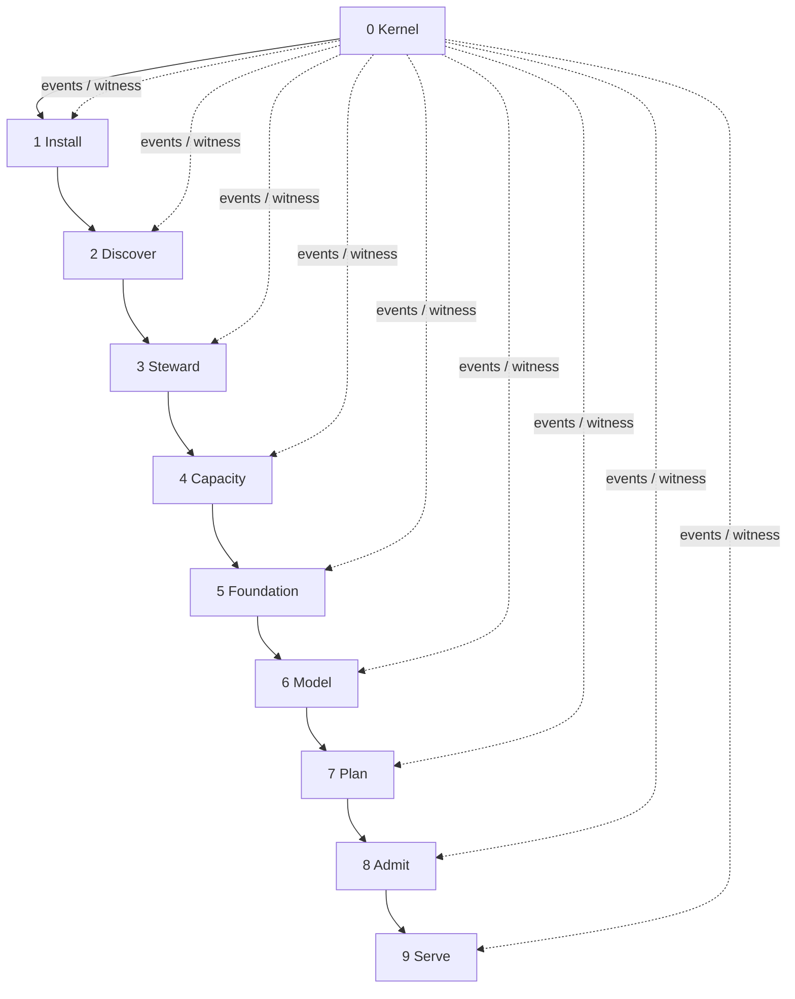
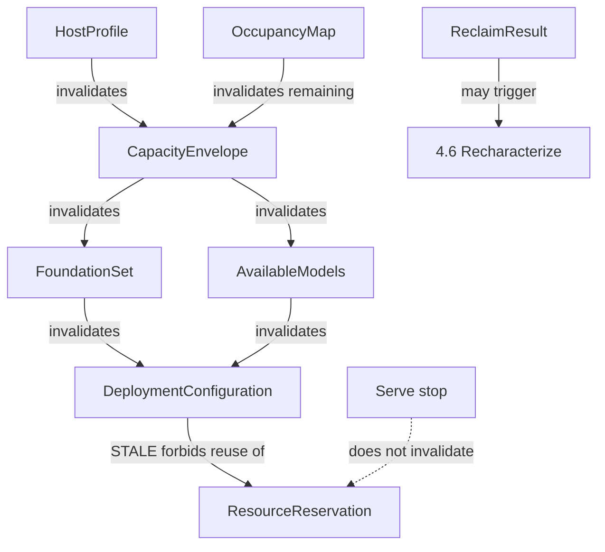
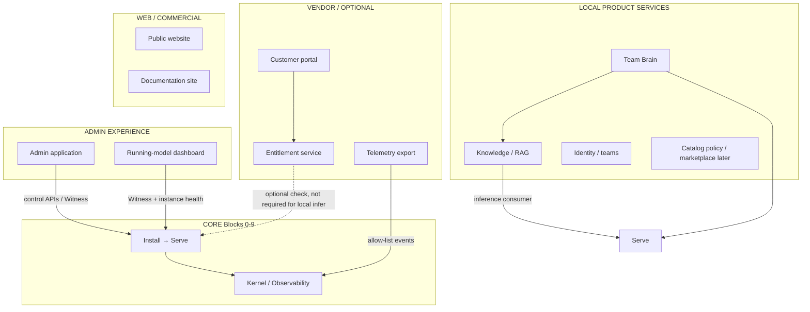

# Machi architecture

**Work token:** `MACHI-0.0.1-ARCHITECTURE`  
**Authority:** Machi product architecture and core sequencing.  
**Kultrun remains:** evidence. Its constitution, module map, and
roadmap are not Machi authorities.

This document is the architecture we would have written **before the
first line of code**, knowing what Kultrun taught.

Entry: [README.md](README.md). Evidence: [KULTRUN.md](KULTRUN.md).
Contracts: [CONTRACTS.md](CONTRACTS.md). Observability:
[TELEMETRY.md](TELEMETRY.md). Build order: [ROADMAP.md](ROADMAP.md).

---

# 1. Mission and scope

Machi installs onto existing compute and produces a **governed,
resource-admitted, locally verified model service**.

The core product is not a chatbot, not Docker, not a capacity
spreadsheet, and not an Admin dashboard. Those may attach later.

**Core boundary:** from invoking a Machi artifact on a supported host
through a **request** inference that proves the selected model, with
durable configuration, reservation, events, and a witness that can
explain the journey without logs.

**Out of core (attach later):** Knowledge/RAG, teams, Team Brain,
marketplace UX, licensing backends, public website, fleet,
optimization products.

**In core from day one:** observability (events, provenance, local
metrics spine). Not the warehouse. Not the dashboard.

---

# 2. Clean-slate principle

Machi is implemented from scratch.

It is not a rename, a package move, or a duty to preserve Kultrun
module files. KEEP in the traceability table means **the invariant and
the lesson**.

---

# 3. Relationship to Kultrun

Kultrun (this repository, `src/kultrun/`) proved that a walking
skeleton on real NVIDIA hardware is possible, and that storage,
ownership, leftover installs, and honest reporting are part of that
skeleton — not polish.

Kultrun also showed that **too many separately shipped stages** make
the primary flow unreadable, and that a report which live-re-resolves
capacity after install will lie.

Machi keeps the proven invariants, collapses the stage sprawl into
**nine Blocks plus Kernel**, and makes events first-class.

---

# 4. Architectural principle (plain language)

Machi is a **short, testable pipeline** that answers, in order:

1. Who are we on this disk?
2. What does this machine appear to contain?
3. What leftover Machi-owned bytes should we keep or delete?
4. What may we safely consume?
5. How will we run software, and did we actually install it?
6. Which model is allowed, chosen, and present locally?
7. What exact configuration will we run?
8. May we run it **now**?
9. Did a real request get a real answer?

Under that pipeline, changing an earlier answer **invalidates** later
ones. It does not silently rewrite them. A ResourceManager is the
only thing that may say yes to step 8. Docker is an adapter, never
the product.

---

# 5. Hierarchy

| Level | Official name | ID shape | Meaning |
|---|---|---|---|
| 1 | **Block** | `1` | Independently shippable building block of the installation-to-inference spine. Has one primary output contract. Roadmap milestone maps 1:1 (M1 implements Block 1, …). |
| 2 | **Capability** | `1.1` | A major responsibility inside a Block. Still a named contract or gate. |
| 3 | **Component** | `1.1.1` | A contained service, port, or adapter. Not a separately shipped product. |

**Block 0 Kernel** is reserved (`0.x`). It is governance and
observability, not a customer-visible deployment step, but it is
implemented first (milestone M0).

There is no Level 4. If a Component needs an internal helper, it is
not an architecture ID.

Work identifiers: `MACHI 1.1.1` means Block 1, Capability 1, Component 1.

---

# 6. Deployment start and completion

**Deployment begins when** a Machi artifact is invoked on a host and
Kernel can persist events. The first *domain* Block is **Install**:
bind a state root, mint `InstallRun`, claim ownership of that tree.
Host discovery is second, because Machi cannot persist or reclaim
honestly without knowing who it is.

**Deployment succeeds when** all of the following are true:

- `DeploymentConfiguration` is CURRENT and persisted;
- `ResourceReservation` is ADMITTED and held;
- `RuntimeCapability` is VERIFIED;
- `ModelArtifact` is local and matches the selection;
- `ReadinessProof` succeeded (not counted as user inference);
- `InferenceProof` with `purpose=request` is PASS and the served
  model identity matches the selection;
- Event journal contains the chain with one `InstallRun`;
- `DeploymentWitness` can be composed from stored contracts + events
  without live re-resolution.

The serving process may be **stopped**. Success does not require it to
still be running. Reservation remains until explicit release.

---

# 7. Diagram B — core flow



Recompute (not a second pipeline) is Diagram E.

---

# 8. Diagram C — hierarchy (shape)

```text
0 Kernel
  0.1 Contracts
      0.1.1 Registry
      0.1.2 Unresolved
  0.2 Record identity
      0.2.1 Typed IDs
  0.3 Events
      0.3.1 EventRecord
      0.3.2 Journal
      0.3.3 Observers
  0.4 Persistence
      0.4.1 Store port
  0.5 Privacy
      0.5.1 Classification
  0.6 Witness
      0.6.1 DeploymentWitness
  0.7 Health
      0.7.1 Aggregator
1 Install
  1.1 Install identity
      1.1.1 InstallRecord
  1.2 State root
      1.2.1 StateRootBinder
  1.3 Self-ownership
      1.3.1 SelfOwnershipMarker
      1.3.2 RegistrySeed
  1.4 InstallRun
      1.4.1 InstallRunStore
2 Discover
  2.1 Environment
  2.2 CPU / RAM
  2.3 Accelerators
  2.4 Mounts
3 Steward
  3.1 Ownership
  3.2 Occupancy
  3.3 Reclaim
4 Capacity
  4.1 Pool identity
  4.2 Characterization
  4.3 Envelope
  4.4 Remaining
  4.5 Host minimum
  4.6 Recharacterize
5 Foundation
  5.1 Executors
  5.2 Runtime catalogue
  5.3 Resolve
  5.4 Provision
  5.5 Verify
  5.6 Select
6 Model
  6.1 Catalog
  6.2 Compatibility
  6.3 Capacity funnel
  6.4 Select
  6.5 Acquire
7 Plan
  7.1 Compose
  7.2 CURRENT / STALE
  7.3 Recipe
8 Admit
  8.1 Snapshot
  8.2 ResourceManager
  8.3 Reservation lifecycle
9 Serve
  9.1 Instance
  9.2 Execute
  9.3 Readiness
  9.4 Request inference
  9.5 Reconcile
  9.6 Usage emission
```

---

# 9. Top-level architecture table

| ID | Block | Purpose | Capabilities | Adapters | Primary input | Primary output | Primary telemetry |
|---|---|---|---|---|---|---|---|
| 0 | Kernel | Mechanisms, events, witness | 0.1–0.7 | store, disabled export | none | EventRecord, Witness | `kernel.alive` |
| 1 | Install | This copy on this disk | 1.1–1.4 | none at v0 | artifact | `StateRootBinding` (1.2.1); `LocalOwnershipEstablishment` (1.3.1; not dual proof); later InstallRecord, InstallRun, registry (1.3.2) | `install.state_root.bound` (1.2.1); `install.ownership.local_marked` (1.3.1); `install.bound` (1.4.1) |
| 2 | Discover | Observe the machine | 2.1–2.4 | OS, NVIDIA, fixture | InstallRecord | HostProfile | `discover.completed` |
| 3 | Steward | Own, classify, reclaim | 3.1–3.3 | filesystem markers | HostProfile | OccupancyMap, ReclaimResult | `steward.*` |
| 4 | Capacity | What may be consumed | 4.1–4.6 | posix, fuse, quota, sonar writer | OccupancyMap | CapacityEnvelope, HostMinimumVerdict | `capacity.*` |
| 5 | Foundation | How software will run | 5.1–5.6 | native process, container, vLLM provision | Envelope | FoundationSelection, RuntimeCapability | `foundation.*` |
| 6 | Model | What weights to serve | 6.1–6.5 | Hub/fixture acquire | RuntimeCapability | ModelSelection, ModelArtifact | `model.*` |
| 7 | Plan | Authoritative configuration | 7.1–7.3 | none | selections + artifacts | DeploymentConfiguration | `plan.*` |
| 8 | Admit | Authorize now | 8.1–8.3 | none (policy core) | Configuration | ResourceReservation | `admit.*` |
| 9 | Serve | Run and prove a request | 9.1–9.6 | native process, vLLM runtime | Reservation + Configuration | InferenceProof | `serve.*` `inference.completed` |

---

# 10. Why this sequence

**Install is first** because persistence, ownership, and correlation
need a root. Kultrun put `install` in tier 9 (component apt). The
product-install of Machi itself is a different concept and empirically
happens before `kultrun host`.

**Discover is second** because Steward and Capacity need mounts and
accelerators, and must not invent them.

**Steward is before Capacity** because leftover owned bytes change
remaining, and because cleanup is lifecycle, not a capacity hack.
Kultrun learned this on a host with sibling trees: UNKNOWN parents hid
RECLAIMABLE children; accounted usage ignored siblings; Sonar had to
run again after delete.

**Capacity before Foundation** because pip/runtime peaks are
admitted against SAFE remaining, not `df`.

**Foundation before Model** because Available Models are
runtime-specific. Estimated-feasible is not available until
calibration/capability exists.

**Plan before Admit** because execution must derive from a consistent
configuration. Admission without a plan is a queue. Kultrun
`planning ⟂ resource` is preserved: Plan does not authorize.

**Admit before Serve** because executors must never decide.

**Serve last** because it is the only Block that must talk to a real
model. Witness is Kernel 0.6, updated continuously, accepted at M9.

**Graph under the sequence:** after reclaim, Capacity 4.6 may
re-enter characterization. Changing ModelSelection invalidates Plan
(STALE) and requires re-admit. Stop does not re-enter Admit.

This is simpler than Kultrun because the **user-visible spine is nine
Blocks**, not 1.1…1.6L4b, while Capabilities still protect concept
ownership.

---

# 11. Block definitions

Each Block below is the required top-level definition.

## 0 Kernel

**ID:** 0  
**Name:** Kernel  
**High-Level Purpose:** Mechanisms every Block shares; no machine
policy.  
**Short Description:** Contracts, Unresolved, IDs, event journal,
persistence port, privacy, witness projection, health aggregation.

**Major Components:** 0.1 Contracts, 0.2 IDs, 0.3 Events, 0.4 Store,
0.5 Privacy, 0.6 Witness, 0.7 Health.

**Approved Kernel increment (0.4.1, accepted):**

| ID | Name | Role | Status |
|---|---|---|---|
| `0.4.1` | Store | Persist/retrieve versioned entity contracts by caller-owned key | accepted |

`Store` is a Kernel port. The filesystem adapter is `FileStore` under
`adapters/persistence`. The journal remains a separate port. Store is
not event-sourced, does not choose its root, and does not implement
RegistrySeed.

**Adapters:** persistence filesystem; disabled telemetry export.

**Inputs:** none.  
**Outputs:** EventRecord, DeploymentWitness, health document.  
**Preconditions:** artifact present.  
**Success:** events persist and round-trip.  
**Failure / Blocked:** store unwritable → FAIL, do not invent success.  
**State owned:** none of the machine; owns mechanisms.  
**Persistence:** journal + store port.  
**Side effects:** files under state root after Install exists.  
**Downstream:** every Block.  
**Re-entry:** `kernel.alive` may be invoked again; each invocation
appends a **new** EventRecord with a new `event_id`. That is journal
append, not a singleton and not operational state.  
**Idempotence:** event IDs unique; composing Witness (later) is pure.  
**Invalidated by:** nothing domain-level.  
**Recompute:** Witness always derived.  
**Analytics / Telemetry:** owns the envelope.  
**Independent test:** T0 + T2 identity.  
**Cumulative test:** M0.  
**Kultrun lessons:** Unresolved; unused `kernel.Event` vs live
OperationalFact — merge; report must not live-re-resolve.

## 1 Install

**ID:** 1  
**Name:** Install  
**Purpose:** Bind this Machi copy to a disk tree and a correlation
identity.  
**Short Description:** Artifact identity, state root, self ownership,
InstallRun.

**Approved Components (M1):**

| ID | Name | Role | Status |
|---|---|---|---|
| `1.2.1` | StateRootBinder | Resolve, normalize, establish the filesystem root | accepted |
| `1.3.1` | SelfOwnershipMarker | Local ownership evidence for this bound root (`LOCAL_MARKER_PRESENT`) | accepted |
| `1.3.2` | RegistrySeed | Local control-plane registry half; cites 1.3.1; not dual-proof evaluation | accepted |
| `1.1.1` | InstallRecord | Stable installation identity; create-once InstallId; creation-build provenance | accepted |
| `1.4.1` | InstallRunStore | Mint/reuse InstallRun; complete Install correlation | this increment |

Working implementation order: `1.2.1` → `1.3.1` → `1.3.2` → `1.1.1` → `1.4.1`.
Location before local evidence before central registry before install identity
before correlation. Wheel `BUILD.json` remains Kernel (M0); `1.1.1` is not
“identity in the wheel”.

**Dual ownership is two authorities, not one file.**

The ownership registry is the **local customer Machi control plane**.
It is not a vendor cloud, website, or subscription service. Machi
ownership must keep working offline. Future fleet/vendor systems may
consume permitted metadata later; they are not the primary authority
for local resources.

- `1.3.1` proves: a valid Machi local marker exists for this bound state root.
- `1.3.1` does **not** prove dual ownership, Install identity, or cleanup rights.
- `1.3.2` persists the matching **local control-plane** registry record that cites the same
  local evidence identity (`marker_id`) and root fingerprint. Registry Store location is
  injected; it is not hard-coded inside the claimed root.
- `1.3.2` still does **not** evaluate dual proof and does **not** authorize destruction.
- Steward `3.1 OwnershipRecord` is later dual-proof evaluation. Do not reuse
  that name for the 1.3.1 local marker or the 1.3.2 registry row.
- `1.1.1` persists a create-once `InstallRecord` keyed by `marker_id`, minting
  one `InstallId`. Build identity on that record is **creation provenance**,
  not current software version. A later compatible build re-enters the
  same InstallId. `install_run_id` and `host_id` stay unresolved.
- `1.1.1` still does **not** evaluate dual proof and does **not** authorize
  destruction. It does not mint InstallRun.
- `1.4.1` persists a create-once `InstallRunRecord` keyed by `InstallId`,
  minting one `InstallRunId` per installation. A later process or compatible
  build re-enters the same run. `host_id` stays unresolved. This is not a
  process, CLI invocation, or host identity, and it is not run history.
- `1.3.2` consumes Kernel `0.4.1` entity Store (Kernel increment; not an Install port).

**Adapters:** none v0 (later: OS package helper is Foundation, not
this).

**Inputs:** invocation, optional `--state-root`, optional `MACHI_STATE_ROOT`.
`1.3.1` consumes `StateRootBinding`; it does not re-resolve the root.
**Outputs:** `StateRootBinding` (1.2.1); `LocalOwnershipEstablishment` (1.3.1);
`LocalOwnershipRegistryRecord` (1.3.2); `InstallRecord` (1.1.1);
`InstallRunRecord` (1.4.1).
Not `OwnershipRecord`.
**Preconditions:** Kernel journal port (directory injected; Kernel does not choose the root).
**Success (1.2.1):** directory exists; `StateRootBinding` returned; `install.state_root.bound` journaled.
**Success (1.3.1):** `.machi-owner.json` created or validated for this fingerprint;
status `local_marker_present`; `dual_ownership=false`; `destructive_authorization=false`;
`install.ownership.local_marked` journaled.
**Success (1.3.2):** injected Store holds a `LocalOwnershipRegistryRecord` citing
the same `marker_id` and root fingerprint; status `registry_seed_present`;
`dual_ownership=false`; `destructive_authorization=false`;
`install.ownership.registry_seeded` journaled.
**Success (1.1.1):** injected Store holds an `InstallRecord` for the same
`marker_id` and root fingerprint; one `InstallId`; status `install_record_present`;
`dual_ownership=false`; `destructive_authorization=false`;
`install.record.established` journaled with resolved `install_id`.
**Success (1.4.1):** injected Store holds an `InstallRunRecord` keyed by
`InstallId`; one `InstallRunId`; status `install_run_present`;
`dual_ownership=false`; `destructive_authorization=false`;
`install.bound` journaled with resolved `install_id` and `install_run_id`;
`host_id` remains unresolved.
**Blocked:** cannot create or write the root; file at path; Kultrun-owned tree;
malformed or conflicting Machi marker; unknown pre-existing content (1.3.1).
**Blocked (1.3.2):** binding and marker disagree; malformed or conflicting registry
row; Store unwritable.
**Blocked (1.4.1):** missing/invalid InstallRecord; malformed or conflicting
InstallRun; Store unwritable. Copied roots never reach 1.4.1.
**State owned (1.2.1):** none beyond the directory itself. Binding is not ownership.
**State owned (1.3.1):** local marker file only. Not the tree as dual-owned property.
**Persistence:** directory create; `.machi-owner.json`; event via Kernel journal under `<root>/journal` unless injected.
**Side effects (1.2.1):** create the bound directory only. No owner marker, no models/runtimes, no sibling scan.
**Side effects (1.3.1):** exclusive create or validate `.machi-owner.json`. Never overwrite, reclaim, or scan siblings.
**Side effects (1.3.2):** exclusive create or validate a registry row in the injected
Store. Never overwrite, reclaim, or write into the claimed state root.
**Side effects (1.1.1):** exclusive create or validate an InstallRecord in the
injected Store (typically the same control-plane Store as 1.3.2, different
kind). Never overwrite, mint InstallRun, or couple identity to a host.
**Side effects (1.4.1):** exclusive create or validate an InstallRunRecord in
the injected Store (same control-plane Store, different kind). Never
overwrite, mint HostId, or rotate a new run per CLI process.
**Downstream:** 1.4.1, then all later Blocks.
**Re-entry (1.2.1):** bind the same valid root again; `existed=true`, `created=false`; append another event.
**Re-entry (1.3.1):** return the same `marker_id` and `created_at`; do not rewrite the file.
**Re-entry (1.3.2):** return the same `marker_id` and `created_at`; do not rewrite the row.
**Re-entry (1.1.1):** return the same `InstallId` and `created_at`; do not rewrite
the row; a different invoking build is not a conflict.
**Re-entry (1.4.1):** return the same `InstallRunId` and `created_at`; do not
rewrite the row; a different invoking build is not a conflict.
**Idempotence:** second bind does not recreate structure. Marker, registry,
InstallId, and InstallRunId are stable.
**Invalidated by:** moving the tree without markers (conflict; copied marker fails closed).
**Recompute:** none.
**Telemetry:** `install.state_root.bound`, `install.ownership.local_marked`,
`install.ownership.registry_seeded`, `install.record.established`, and
`install.bound` (privacy `restricted`; path omitted). The 1.1.1 event carries
a resolved `InstallId` and leaves `install_run_id` unresolved. The 1.4.1
event resolves both `InstallId` and `InstallRunId`; `host_id` stays
unresolved. Earlier events are not rewritten.
Never emit `ownership.verified` from 1.3.1, 1.3.2, 1.1.1, or 1.4.1.
**Independent test:** two roots isolated in one registry, one InstallId and
one InstallRunId each; copied root refused; mismatch fail-closed; later
build re-enters the same InstallId and InstallRunId; concurrent first
create converges on one run; injected Store not inside the claimed root.
**Cumulative:** M0→1.2.1→1.3.1→0.4.1→1.3.2→1.1.1→1.4.1.
**Lessons:** Kultrun K-20 (cwd-relative default, blank env ≠ `/`); default-root warning on artifacts; install≠apt; do not claim `.kultrun-owner.json` trees; do not treat malformed marker JSON as absence; do not store absolute paths on the marker.

## 2 Discover

**ID:** 2  
**Name:** Discover  
**Purpose:** Observe the machine. Never authorize.  
**Short Description:** OS, CPU, RAM, accelerators, mounts, with
provenance.

**Components:** 2.1 environment, 2.2 CPU/RAM, 2.3 accelerators, 2.4
mounts.

**Adapters:** native Linux, NVIDIA, fixture; future hwloc/AMD/Apple.
Adapters observe; they do not decide models.

**Inputs:** InstallRecord.  
**Outputs:** HostProfile, MountObservation[].  
**Preconditions:** Install.  
**Success:** profile persisted; unknowns explicit.  
**Blocked:** unsupported OS/arch may still produce a profile that later
fails 4.5.  
**State owned:** HostProfile.  
**Persistence:** yes.  
**Side effects:** none beyond records (component apt is Foundation).  
**Downstream:** Steward, Capacity, Foundation.  
**Re-entry:** rediscover; new generation.  
**Idempotence:** same fingerprint → new generation if facts changed.  
**Invalidated by:** hardware change (detect on rediscover).  
**Recompute:** invalidates Capacity onward.  
**Telemetry:** `discover.completed`.  
**Independent test:** T1 fixtures.  
**Cumulative:** M0→M2.  
**Lessons:** providers ≠ policy; reported free is observation.

## 3 Steward

**ID:** 3  
**Name:** Steward  
**Purpose:** Know what Machi already owns; delete only what dual proof
allows.  
**Short Description:** Ownership, occupancy classes, reclaim.

**Components:** 3.1 Ownership, 3.2 Occupancy, 3.3 Reclaim.

**Adapters:** filesystem markers; no “delete by path heuristic”
adapter.

**Inputs:** HostProfile, mounts, registry.  
**Outputs:** OccupancyMap, ReclaimPlan, ReclaimResult.  
**Preconditions:** Discover.  
**Success:** classes mutually exclusive; reclaim only dual-owned
CLEANUP ELIGIBLE.  
**Blocked:** conflict, missing marker, UNKNOWN — keep. Failure to
delete a positively identified eligible root **blocks** (fail closed).  
**State owned:** OwnershipRecord, OccupancyMap.  
**Persistence:** yes.  
**Side effects:** deletes eligible trees.  
**Downstream:** Capacity remaining.  
**Re-entry:** classify anytime; reclaim idempotent.  
**Idempotence:** second reclaim of empty set is success with 0 bytes.  
**Invalidated by:** new files on disk (rediscover occupancy).  
**Recompute:** may trigger Capacity 4.6.  
**Telemetry:** `steward.classified`, `steward.reclaim.*`.  
**Independent test:** unique_occupancy; dual proof.  
**Cumulative:** M0→M3.  
**Lessons:** sibling leftovers; UNKNOWN parent; lifecycle vs
capacity flags on one plan.

## 4 Capacity

**ID:** 4  
**Name:** Capacity  
**Purpose:** Interpret observations into SAFE remaining; gate the
minimum host.  
**Short Description:** Pool identity, characterization, envelope,
remaining, host-minimum, recharacterize.

**Components:** 4.1 Pool identity, 4.2 Characterization, 4.3 Envelope,
4.4 Remaining, 4.5 Host minimum, 4.6 Recharacterize.

**Adapters:** posix stat, FUSE identify, Linux quota, ZFS/NFS
specialists, empirical sonar writer. Never model-aware.

**Inputs:** HostProfile, OccupancyMap, ReclaimResult.  
**Outputs:** CapacityEvidence, CapacityEnvelope, HostMinimumVerdict.  
**Preconditions:** Discover; Steward should have run (occupancy may
be empty).  
**Success:** authorizing bytes have provenance; SAFE ≤ authorizing.  
**Blocked:** unresolved authorizing when consume is required; min FAIL
with reason.  
**State owned:** evidence, envelope, verdict.  
**Persistence:** yes (cheap GET must not erase characterization).  
**Side effects:** probe files on the **claimed pool only**.  
**Downstream:** Foundation, Model, Admit.  
**Re-entry:** 4.6 after occupancy drop if SAFE still blocks.  
**Idempotence:** same pool identity reuses evidence until invalidated.  
**Invalidated by:** fingerprint/quota change, occupancy drop, policy
version.  
**Recompute:** directed 4.6, not a global refresh.  
**Telemetry:** sonar tiers, EDQUOT as evidence, min verdict.  
**Independent test:** untrusted FUSE; pool bind mismatch refuses.  
**Cumulative:** M0→M4.  
**Lessons:** df is not quota; probe-the-pool; remaining after usage;
realize-time vs live remaining.

## 5 Foundation

**ID:** 5  
**Name:** Foundation  
**Purpose:** Choose and prove an execution path.  
**Short Description:** Executors, runtimes, resolve, provision, verify,
select.

**Components:** 5.1 Executor catalogue, 5.2 Runtime catalogue, 5.3
Resolve, 5.4 Provision, 5.5 Verify, 5.6 Select.

**Adapters:** NativeProcessExecutor, ContainerExecutor (optional),
vLLM provision/verify; llama.cpp/MLX later.

**Inputs:** HostProfile, CapacityEnvelope, HostMinimum PASS.  
**Outputs:** FoundationSet, FoundationSelection, RuntimeInstallation,
RuntimeCapability.  
**Preconditions:** 4.5 PASS.  
**Success:** selected PRODUCT path VERIFIED.  
**Blocked:** no PRODUCT plausible path; provision fail; verify fail.  
**State owned:** selection, installation, capability.  
**Persistence:** yes.  
**Side effects:** runtime files on destination pool; pip/venv or
equivalent.  
**Downstream:** Model, Plan.  
**Re-entry:** provision idempotent if exact installation matches.  
**Idempotence:** select AUTO stable given same inputs.  
**Invalidated by:** envelope or host change.  
**Recompute:** new FoundationSet; STALE plan.  
**Telemetry:** funnel counts; selected vs recommended.  
**Independent test:** execution ⟂ runtime; CONDITIONAL selectable.  
**Cumulative:** M0→M5.  
**Lessons:** don’t copy foundations[0]; provisionable ≠ executable;
Docker not mandatory.

## 6 Model

**ID:** 6  
**Name:** Model  
**Purpose:** From catalog to a local artifact the host can run.  
**Short Description:** Catalog, compatibility, capacity funnel,
select, acquire.

**Components:** 6.1 Catalog, 6.2 Compatibility, 6.3 Capacity funnel,
6.4 Select, 6.5 Acquire.

**Adapters:** fixture catalog, optional Hub fetch; estimators
advisory.

**Inputs:** RuntimeCapability, CapacityEnvelope remaining.  
**Outputs:** AvailableModels, ModelSelection, ModelArtifact.  
**Preconditions:** verified foundation.  
**Success:** selected member is Available and artifact local.  
**Blocked:** empty Available; acquire fail; infeasible storage.  
**State owned:** views, selection, artifacts, inventory.  
**Persistence:** yes.  
**Side effects:** downloads into owned trees.  
**Downstream:** Plan.  
**Re-entry:** funnel on remaining change.  
**Idempotence:** acquire reuses digest.  
**Invalidated by:** foundation or envelope change.  
**Recompute:** new AvailableModels; STALE plan.  
**Telemetry:** funnel counts; important blocked reasons.  
**Independent test:** estimated ≠ available.  
**Cumulative:** M0→M6.  
**Lessons:** Hub is not compatibility authority; llmfit advisory.

## 7 Plan

**ID:** 7  
**Name:** Plan  
**Purpose:** One internally consistent configuration. Does not launch.  
**Short Description:** Compose DeploymentConfiguration; CURRENT/STALE;
recipe data for Serve.

**Components:** 7.1 Compose, 7.2 Generation, 7.3 Recipe (structured,
not argv in core).

**Adapters:** none.

**Inputs:** FoundationSelection, ModelSelection, artifact, envelope.  
**Outputs:** DeploymentConfiguration, ResourceRequest.  
**Preconditions:** verified runtime + selected model.  
**Success:** CURRENT configuration persisted.  
**Blocked:** inconsistent IDs.  
**State owned:** DeploymentConfiguration.  
**Persistence:** yes.  
**Side effects:** none on GPU/process.  
**Downstream:** Admit, Serve.  
**Re-entry:** compose replaces with new generation.  
**Idempotence:** same inputs → same configuration digest.  
**Invalidated by:** any upstream selection/envelope change → STALE.  
**Recompute:** new configuration; do not mutate ADMITTED
reservation.  
**Telemetry:** `plan.created`, `plan.stale`.  
**Independent test:** cannot import resource.  
**Cumulative:** M0→M7.  
**Lessons:** plan is authority; `--refresh` is explicit.

## 8 Admit

**ID:** 8  
**Name:** Admit  
**Purpose:** Authorize this configuration against **now**.  
**Short Description:** Capacity snapshot, ResourceManager, reservation
lifecycle.

**Components:** 8.1 Snapshot, 8.2 ResourceManager, 8.3 Reservation
states.

**Adapters:** none (POSIX file lock is an implementation of the lock
port, not a policy adapter).

**Inputs:** DeploymentConfiguration, live CapacitySnapshot.  
**Outputs:** ResourceReservation or typed rejection.  
**Preconditions:** CURRENT plan.  
**Success:** ADMITTED reservation.  
**Blocked:** insufficient SAFE remaining; device busy per policy.  
**State owned:** reservations, ledger.  
**Persistence:** yes.  
**Side effects:** none on processes.  
**Downstream:** Serve.  
**Re-entry:** stop does not release.  
**Idempotence:** same request ID does not double-count.  
**Invalidated by:** STALE plan (must not reuse reservation).  
**Recompute:** new request.  
**Telemetry:** `admit.completed` / `.rejected`.  
**Independent test:** executor cannot call admit.  
**Cumulative:** M0→M8.  
**Lessons:** single author; stop ≠ release.

## 9 Serve

**ID:** 9  
**Name:** Serve  
**Purpose:** Materialize the admitted configuration and prove a
request.  
**Short Description:** Instance, executor, readiness, request
inference, reconcile, usage emission.

**Components:** 9.1 Instance, 9.2 Execute, 9.3 Readiness, 9.4
Request inference, 9.5 Reconcile, 9.6 Usage.

**Adapters:** NativeProcessExecutor, vLLM runtime (argv, HTTP,
readiness). Core does not import subprocess.

**Inputs:** CURRENT configuration, ADMITTED reservation.  
**Outputs:** ServingInstance, ReadinessProof, InferenceProof.  
**Preconditions:** Admit PASS.  
**Success:** request inference PASS; model identity matches.  
**Blocked:** readiness timeout (stop process, keep reservation);
inference fail.  
**State owned:** instance, endpoint, desired vs observed vs health.  
**Persistence:** instance records; **not** prompts/responses.  
**Side effects:** process, GPU memory, loopback port, capture files.  
**Downstream:** Witness, future Gateway.  
**Re-entry:** restart uses same reservation.  
**Idempotence:** start is not; reconcile is.  
**Invalidated by:** STALE plan (must not start).  
**Recompute:** none for inference proof (immutable).  
**Telemetry:** lifecycle; `inference.completed` purpose=request.  
**Independent test:** purpose filter; identity cookie.  
**Cumulative:** M0→M9.  
**Lessons:** runtime-owned readiness; capture lifetime; IPC path
cleanup on stop.

---

# 12. Full core hierarchy

```text
0 Kernel
  0.1 Contracts
    0.1.1 Contract registry
    0.1.2 Unresolved semantic
  0.2 Record identity
    0.2.1 Typed prefixed IDs
  0.3 Events
    0.3.1 EventRecord envelope
    0.3.2 Append journal
    0.3.3 Non-blocking observers
  0.4 Persistence
    0.4.1 Store port (injected root; FileStore adapter; create + get; not the journal)
  0.5 Privacy
    0.5.1 Classification + export allow-list
  0.6 Witness
    0.6.1 DeploymentWitness composer
  0.7 Health
    0.7.1 Aggregator
1 Install
  1.1 Install identity
    1.1.1 InstallRecord (binds Kernel build identity into install-scoped state)
  1.2 State root
    1.2.1 StateRootBinder
  1.3 Self-ownership
    1.3.1 SelfOwnershipMarker
    1.3.2 RegistrySeed (local control-plane registry half)
  1.4 InstallRun
    1.4.1 InstallRunStore (reuse across processes; this increment)
2 Discover
  2.1 Environment
    2.1.1 OS/arch adapter
  2.2 CPU / RAM
    2.2.1 Memory observer
  2.3 Accelerators
    2.3.1 NVIDIA adapter
    2.3.2 Fixture provider
  2.4 Mounts
    2.4.1 Mount enumerator
3 Steward
  3.1 Ownership
    3.1.1 Dual-proof records
    3.1.2 Conflict detection
  3.2 Occupancy
    3.2.1 Classifier (ACTIVE/REUSABLE/PROTECTED/RECLAIMABLE/UNKNOWN)
    3.2.2 unique_occupancy
  3.3 Reclaim
    3.3.1 Planner (lifecycle vs capacity flags)
    3.3.2 Executor (fail closed)
4 Capacity
  4.1 Pool identity
    4.1.1 Mount + quota + fingerprint
  4.2 Characterization
    4.2.1 Specialist probe port
    4.2.2 Empirical sonar (pool-bound)
    4.2.3 Corroboration
  4.3 Envelope
    4.3.1 SAFE policy
  4.4 Remaining
    4.4.1 Remaining after occupancy
  4.5 Host minimum
    4.5.1 HostMinimumVerdict
  4.6 Recharacterize
    4.6.1 Occupancy-conditional re-sonar
5 Foundation
  5.1 Executors
    5.1.1 Native process descriptor
    5.1.2 Container descriptor (optional)
  5.2 Runtime catalogue
    5.2.1 Support descriptors (vLLM product; others FUTURE)
  5.3 Resolve
    5.3.1 Compatibility classes
  5.4 Provision
    5.4.1 Exact installation
  5.5 Verify
    5.5.1 RuntimeCapability
  5.6 Select
    5.6.1 AUTO / MANUAL
6 Model
  6.1 Catalog
    6.1.1 Internal catalog
  6.2 Compatibility
    6.2.1 Runtime-aware prefilter
  6.3 Capacity funnel
    6.3.1 Storage/RAM/VRAM vs envelope
  6.4 Select
    6.4.1 AUTO / MANUAL
  6.5 Acquire
    6.5.1 Local artifact + inventory
7 Plan
  7.1 Compose
    7.1.1 DeploymentConfiguration
  7.2 Generation
    7.2.1 CURRENT / STALE
  7.3 Recipe
    7.3.1 Structured launch fields
8 Admit
  8.1 Snapshot
    8.1.1 CurrentCapacitySnapshot
  8.2 ResourceManager
    8.2.1 Admit / reject
  8.3 Reservation lifecycle
    8.3.1 Hold across stop
9 Serve
  9.1 Instance
    9.1.1 Inference instance (no planning import)
  9.2 Execute
    9.2.1 NativeProcessExecutor adapter
  9.3 Readiness
    9.3.1 Runtime-owned inspect
  9.4 Request inference
    9.4.1 Bounded generate; purpose=request
  9.5 Reconcile
    9.5.1 Reacquire / stop
  9.6 Usage
    9.6.1 Non-blocking usage event
```

---

# 13. Adapter architecture

Adapters exist only where the **technology varies**.

| Port owner | Adapter examples | Must not |
|---|---|---|
| Discover | Linux, NVIDIA, fixture | Decide SAFE, models, or admission |
| Capacity | posix, FUSE, quota, ZFS, sonar writer | Know model IDs |
| Foundation | native process, Docker engine, vLLM pip | Admit resources |
| Model | Hub, fixture | Authorize compatibility by existing on disk |
| Serve | vLLM HTTP/readiness | Persist prompts |
| Kernel | disabled export | Block inference on export fail |

An adapter inherits the import budget of the Block whose port it
implements (Kultrun Law 5). Native process is first-class.

---

# 14. Dependency / invalidation (Diagram E)



No generic workflow engine. The composition root sequences these
edges. That is the Kultrun `platform` job, **narrowed**: it must not
grow a second ResourceManager or a second Capacity.

---

# 15. Persistence boundaries

| Kind | Where | Notes |
|---|---|---|
| State | entity records in the store | current truth |
| Events | append journal | what happened |
| Artifacts | owned trees under state root / destination pool | dual-owned |
| Capture | process logs | rotate; not analytics |
| Probe | `.machi-sonar` on the **pool** | disposable, dual-owned |

Raw filesystem capacity never authorizes a mutation.

---

# 16. Invariants (treatment)

| Invariant | Machi treatment |
|---|---|
| Physical resource truth | KEEP — RAM, VRAM, unified, disk, ports distinct |
| Dynamic capacity | KEEP — no stored/active partition product |
| Hard admission | KEEP — Block 8 only |
| Storage truth | KEEP — logical allocation ≠ physical reservation; remaining after occupancy |
| Bounded manual overrides | KEEP — cannot override impossibility; last-resort capacity is typed |
| Dependency recomputation | KEEP — STALE plan; directed invalidation |
| Runtime responsibility split | KEEP — set / provision / verify / select |
| Controlled execution | KEEP — native process required on supported hosts |
| Ownership | KEEP — dual proof |
| Safe destruction | KEEP — fail closed |
| Authoritative configuration | KEEP — Block 7 |
| Customer data control | KEEP — prompts never in events; vendor default off |

---

# 17. Core vs outer product (Diagram G)



**Local Machi without network must:** Install through Serve,
Witness, local events, stop/restart.

UI never owns reservations. Vendor never owns HostProfile.

**Future domains that may add core interfaces:** Gateway/auth (identity
enforcement in front of Serve), concurrent instances (deepen 8 and 9),
additional Foundation descriptors. They extend catalogues and
policies; they do not add a second admission author.

---

# 18. Customer / vendor / fleet

| Plane | Runs where | Required for local inference |
|---|---|---|
| Customer deployment | customer host | yes |
| Enterprise/fleet | optional customer ops | no |
| Vendor systems | Machi operator | no |
| Public web | public | no |

---

# 19. Empirical test model

See [ROADMAP.md](ROADMAP.md). Principle: each Block is a **BUILD
UNIT** with T0/T1, T2 artifact, T3/T5 when the Block touches hardware.
Cumulative `M0→…→Mn`. Server is a deployment target. Source stays in
the development workspace.

---

# 20. Implementation principles

- Core owns concepts; adapters own implementations.
- One concept, one Capability.
- Composition root sequences; it does not re-decide.
- Fail conservatively; Unresolved is valid.
- Facts immutable; new generation on change.
- Thin end-to-end (M0–M9) before deepening any Block.
- No third-party technology is a semantic owner.
- Architecture tests enforce non-edges from the first code milestone.

---

# 21. Extension points

- New HostDiscoveryProvider
- New storage specialist
- New executor / runtime descriptor
- New model source
- Gateway as a consumer of Serve
- Analytics UI as a consumer of Witness + metrics
- Knowledge as a consumer of Serve

None of these may import ResourceManager to “just admit.”

---

# 22. Simplifications (summary)

Full rows also appear in PASTE BACK N. Headline:

| Kultrun | Machi | Why | Lesson kept | Risk |
|---|---|---|---|---|
| 20+ stages 1.1–1.6L4b | 9 Blocks + Kernel | readable spine | concept owners as Capabilities | smuggling two concepts into one Block — tests + Must-not |
| OperationalFact + Event + UsageEvent + TelemetryRecord | EventRecord + projections | one spine | sanitizer, purpose, correlation | payload bloat — privacy class |
| Report live-re-resolves | Witness from journal + stored contracts | physical FILTERED-selected | realize vs remaining | stale witness — compose time is now, sources are stored |
| install at tier 9 | Block 1 | empirically first | apt stays Foundation adapter | mixing OS packages into Install |
| Min feasibility as a peer identity | 4.5 | one envelope, one gate | strict PASS/FAIL | hiding the gate — keep HostMinimumVerdict |
| Storage L2–L5 as product stages | 4.2 capabilities | storage is not the product | pool bind, EDQUOT, remaining | deepening 4 before M9 — roadmap non-goals |
| platform dumps everything | composition root + 0.6 | sequencing without a second brain | invalidation in one place | root becomes dump again — Must-not list |

---

# 23. Instruction improvements / engineering corrections

1. **Instruction assumption:** telemetry is a core *and* a late
   dashboard. **Issue:** those are different. **Correction:** events in
   Kernel from M0; dashboards attach to Witness. **Why:** Kultrun
   analytics contracts existed unused while OperationalFact did the
   real work.

2. **Instruction assumption:** cleanup/feasibility/discovery might
   each be top-level modules. **Correction:** Discover, Steward,
   Capacity are three Blocks because their outputs differ; they are
   not twenty stages. Cleanup is Steward 3.3. **Why:** physical sibling
   reclaim is not a footnote of discovery.

3. **Instruction assumption:** a linear flow is enough. **Correction:**
   primary flow is linear; 4.6 and STALE are explicit recompute.
   **Why:** occupancy-conditional Sonar was a real second pass.

4. **Instruction assumption:** “capacity planner” is an attached
   product service. **Correction:** SAFE envelope and admission are
   core; the future optimizer UX attaches. **Why:** treating
   admission as a planner UI recreated the previous attempt’s crash.

5. **Instruction assumption:** completion might be “process started.”
   **Correction:** request inference + identity match + Witness.
   Readiness is necessary but not sufficient. **Why:** Kultrun
   readiness probes are not user inference.

6. **Instruction assumption:** start at host discovery. **Correction:**
   Kernel then Install. **Why:** correlation, ownership, and
   `kultrun version` are the actual first proofs.

7. **Instruction assumption:** event-driven internals if telemetry
   matters. **Correction:** not event-sourced. **Why:** admission and
   launch must be direct, synchronous, fail-closed.

8. **Instruction naming:** “AI Deployment Project.” **Correction:**
   the product name is Machi; organisational vision remains Company
   Brain as capability. **Why:** Kultrun already paid for a rename.

---

# 24. What this document is not

It is not an implementation. `src/machi/` must not appear until a
later instruction consumes `CHAIN_OUT`.
