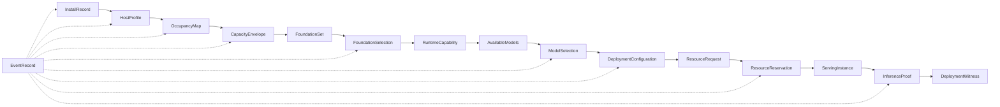

# Machi contracts

**Role:** supporting. Semantics live in [ARCHITECTURE.md](ARCHITECTURE.md).
This is the named chain a milestone can test.

Contracts reference other entities **by identifier**, not by import.
Unknown is `Unresolved`, never zero, never a pass.

---

# 1. Semantic categories

| Category | Meaning | Example |
|---|---|---|
| Observation | Raw or adapter-normalized fact about the world | `HostObservation`, `MountObservation` |
| Profile | Machi-owned normalization | `HostProfile` |
| Evidence | Measurement with provenance | `CapacityEvidence` |
| Inventory | Owned bytes and their class | `OccupancyMap` |
| Envelope | Policy interpretation of evidence | `CapacityEnvelope` |
| Feasible set | What remains possible | `FoundationSet`, `AvailableModels` |
| Recommendation | Ranked preference, not authority | `FoundationRecommendation` |
| Selection | Chosen alternative (AUTO or MANUAL) | `FoundationSelection`, `ModelSelection` |
| Artifact | Durable acquired object | `ModelArtifact`, `RuntimeInstallation` |
| Configuration | Authoritative intended execution | `DeploymentConfiguration` |
| Request | What admission is asked to grant | `ResourceRequest` |
| Reservation | What admission granted | `ResourceReservation` |
| Runtime state | Desired vs observed serving | `ServingInstance` |
| Proof | Bounded real result | `InferenceProof` |
| Witness | Read-time projection | `DeploymentWitness` |
| Event | Immutable record that something happened | `EventRecord` |

Recommendation never authorizes. Reservation never launches.

---

# 2. Main contract chain

```text
StateRootBinding
    → LocalOwnershipEstablishment   (1.3.1 local marker only; not dual proof)
    → (1.3.2 registry record; not implemented)
    → InstallRecord
    → HostProfile
    → OccupancyMap
    → CapacityEnvelope
    → FoundationSet
    → FoundationSelection
    → RuntimeInstallation + RuntimeCapability
    → AvailableModels
    → ModelSelection + ModelArtifact
    → DeploymentConfiguration
    → ResourceRequest
    → ResourceReservation
    → ServingInstance
    → InferenceProof
    → DeploymentWitness
```

Every arrow is an explicit producer/consumer pair. Changing an
upstream contract **invalidates** dependents (see §4). It does not
rewrite them in place.

---

# 3. Contract catalogue (core)

| Name | Producer | Consumers | Category | Persist | Provenance required |
|---|---|---|---|---|---|
| `EventRecord` | every block | journal, Witness, export | Event | append-only | emitter Block ID + payload version |
| `StateRootBinding` | 1.2.1 StateRootBinder | 1.3.1, 1.1.1, 1.4.1, composition | Profile / location | directory exists; contract is returned, not an entity file yet | selection source |
| `LocalOwnershipMarker` | 1.3.1 SelfOwnershipMarker | 1.3.2, composition, later Steward | Evidence (local only) | `.machi-owner.json` | schema, product `machi`, `marker_id`, root fingerprint |
| `LocalOwnershipEstablishment` | 1.3.1 SelfOwnershipMarker | composition; never Steward delete | Evidence (local only) | no; result of establish | `dual_ownership=false`, `destructive_authorization=false` |
| `InstallRecord` | 1.1.1 InstallRecord | all | Profile | yes | artifact SHA, build id, bound root |
| `InstallRun` | 1.4.1 InstallRunStore | EventRecord.correlation | Profile | yes | state root |
| `HostObservation` | 2 adapters | Discover | Observation | optional raw | adapter name, tool version |
| `HostProfile` | 2 Discover | Capacity, Foundation, Admit | Profile | yes | observation IDs |
| `MountObservation` | 2.4 | Capacity | Observation | yes | path, fs type, reported free flagged |
| `OwnershipRecord` | 3.1 | Steward, reclaim | Inventory | yes | dual proof (local marker **and** registry). Not the 1.3.1 contract. |
| `OccupancyMap` | 3.2 | Steward, Capacity remaining | Inventory | yes | classifier version |
| `ReclaimPlan` / `ReclaimResult` | 3.3 | Capacity recharacterize | Inventory | yes | dual-owned roots only |
| `CapacityEvidence` | 4.2 | Envelope | Evidence | yes | pool identity, method, bounds |
| `CapacityEnvelope` | 4.3 | Feasibility, Foundation, Model, Admit | Envelope | yes | evidence IDs, policy version |
| `HostMinimumVerdict` | 4.5 | Install progress, Foundation | Feasible set / gate | yes | profile version, realize-time bytes |
| `FoundationSet` | 5.3 | Select | Feasible set | yes | HostProfile + Envelope IDs |
| `FoundationSelection` | 5.6 | Provision, Plan | Selection | yes | recommended vs selected |
| `RuntimeInstallation` | 5.4 | Verify, Plan | Artifact | yes | exact version, path, size |
| `RuntimeCapability` | 5.5 | Model funnel | Profile | yes | verify method |
| `ModelCatalogView` | 6.1 | funnel | Observation | derived | catalog generation |
| `AvailableModels` | 6.3 | Select | Feasible set | yes | Envelope + RuntimeCapability IDs |
| `ModelSelection` | 6.4 | Plan, Acquire | Selection | yes | mode AUTO/MANUAL |
| `ModelArtifact` | 6.5 | Plan, Serve | Artifact | yes | digest, bytes, source |
| `DeploymentConfiguration` | 7 Plan | Admit, Serve | Configuration | yes | CURRENT vs STALE |
| `ResourceRequest` | 7→8 | Admit | Request | yes | configuration ID |
| `CapacitySnapshot` | 8.1 | Admit | Envelope (now) | yes | envelope generation |
| `ResourceReservation` | 8.2 | Serve | Reservation | yes | request ID, devices |
| `ServingInstance` | 9.1 | Serve, Witness | Runtime state | yes | configuration + reservation IDs |
| `ReadinessProof` | 9.3 | Serve | Proof | yes | not a user inference |
| `InferenceProof` | 9.4 | Witness, usage | Proof | yes | purpose=request; no prompt text |
| `DeploymentWitness` | 0.6 | CLI, API, Admin | Witness | derived | InstallRun + fact IDs |

Lifecycle: observations and events are immutable. Profiles and
selections are replaced by a new generation when invalidated.
Reservations are released only by explicit release, not by stop.

Versioning: `kind` + integer version, same as Kultrun `contract()`.
A change of meaning keeps a new version. Name reuse with a new
meaning is a human-reviewed event (Kultrun K-05).

`LocalOwnershipMarker` is not `OwnershipRecord`. Steward 3.1 keeps that
name for dual-proof inventory. 1.3.1 status is `local_marker_present`,
never `ownership_verified`.

---

# 4. Invalidation

```text
HostProfile changes
    invalidates CapacityEnvelope, FoundationSet, AvailableModels,
    DeploymentConfiguration (STALE), not a live reservation until re-admit

OccupancyMap / ReclaimResult changes
    invalidates remaining in CapacityEnvelope; may require recharacterize

CapacityEnvelope changes
    invalidates HostMinimumVerdict, FoundationSet, AvailableModels, Plan

FoundationSelection or RuntimeCapability changes
    invalidates AvailableModels, Plan

ModelSelection or ModelArtifact changes
    invalidates Plan

DeploymentConfiguration STALE
    invalidates ResourceRequest; existing reservation must not be
    reused for a different configuration

Stop ServingInstance
    does not invalidate Reservation or Plan
```

Recompute is **explicit and directed**, not a workflow engine. The
control plane (composition root) sequences invalidation. Domains do
not import each other to “refresh the world.”

---

# 5. Diagram D — contract flow


