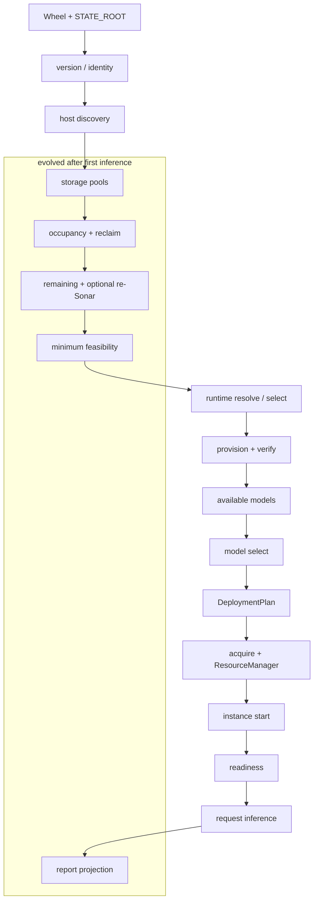

# Kultrun as evidence

**Role:** supporting. Canonical Machi architecture is
[ARCHITECTURE.md](ARCHITECTURE.md).

This document records what Kultrun actually is in this repository at
`c4da455` (`stage/storage-sonar-pool-binding-recovery`), what it proved
on a real GPU host, and how each significant concept is treated in
Machi.

Kultrun code is **not** Machi code. Conceptual KEEP means the lesson
and the invariant, not a package to copy.

---

# 1. Repository snapshot used as evidence

| Item | Value |
|---|---|
| Workspace | `/Users/usyd/Projects/ai-stack-storage-v2` |
| Evidence HEAD | `c4da4552981193494c4cb9b6df958b3643751430` |
| Branch of evidence | `stage/storage-sonar-pool-binding-recovery` |
| Authoritative Kultrun branch | `kultrun` at `1e51f13` (1.6K closed; this workspace is ahead on storage/report/cleanup) |
| Previous attempt | `main` / `phase9`; 58,706 lines; never reached live inference |
| Package | `src/kultrun/` ~225 Python modules, `adapters/` as a separate tier |
| CLI | `kultrun {version,host,models,deployments,resources,instances,storage,runtime,runtimes,report,serve}` |
| Control-plane API | loopback HTTP; prototype console is a display, not a planner |
| Tests | `tests/architecture.py` enforces the dependency law; T0–T5 modes in `docs/TESTING_STRATEGY.md` |
| Physical reference | `host_4abec3f2e600e339`, NVIDIA RTX PRO 4500 Blackwell, `/workspace` FUSE/MooseFS; DeploymentRun `drun_c84d8a065b69bbf9` |

---

# 2. What Kultrun actually became

Kultrun is a **capability-based, adapter-backed control plane** that
can take a Linux/NVIDIA host from an installed wheel to a **native
vLLM process answering a bounded request**, then stop and restart
without releasing the reservation.

It is also still a **thin Company Brain constitution** with empty
packages (`knowledge`, `training`, `brains`, `agents`, `gateway`
routing, analytics usage pipeline) declared so they cannot disappear.

## 2.1 Actual installation-to-inference flow (proven)

```text
wheel install + KULTRUN_STATE_ROOT
    → kultrun version (artifact identity)
    → host discovery → HostCapabilities
    → storage pools + Sonar/specialist → authorizing bytes + SAFE
    → occupancy classify (ACTIVE/REUSABLE/PROTECTED/RECLAIMABLE/UNKNOWN)
    → StorageReclaimPlan of dual-owned CLEANUP ELIGIBLE roots
    → remaining after managed usage; optional occupancy-conditional re-Sonar
    → MinimumFeasibilityAssessment (PASS/FAIL, never a boolean elsewhere)
    → RuntimeResolver candidates (COMPATIBLE/CONDITIONAL/UNSUPPORTED)
    → FoundationSelection AUTO
    → provision + verify native vLLM
    → Available Models funnel (catalog → compat → storage/RAM/VRAM)
    → ModelSelection AUTO
    → DeploymentPlan CURRENT
    → acquire artifact (or reuse) + ResourceManager ADMITTED
    → InferenceInstance create/start
    → runtime-owned readiness (alive + /health + served-model)
    → inference purpose=request
    → stop (GPU process gone, reservation held) → restart → infer again
    → kultrun report (projection of OperationalFact + domain state)
```

That path is **PROVEN** on the physical host above, including product
deletion of **19.5 GiB** sibling `models`/`runtimes` (no operator `rm`).

## 2.2 Status of major surfaces

| Area | Status | Evidence |
|---|---|---|
| Kernel (IDs, contracts, Unresolved, file store) | IMPLEMENTED | `src/kultrun/kernel/`; architecture tests |
| Host discovery (Linux + NVIDIA) | PROVEN | `kultrun host`; fixtures replay |
| Storage pools, specialist, Sonar, remaining | PROVEN | FUSE untrusted; EDQUOT; authorizing 32 GiB |
| Dual ownership + reclaim | PROVEN | 19.5 GiB sibling reclaim; UNKNOWN journals kept |
| Minimum feasibility | PROVEN | realize PASS vs post-install remaining distinguished in report after `b12ce09` |
| NativeProcessExecutor | PROVEN | pid, loopback, identity cookie, capture lifetime |
| ContainerExecutor | IMPLEMENTED / PARTIAL | L2 Docker engine; GPU assignment not product path |
| vLLM native serving | PROVEN | 0.28.0, qwen2.5-7b-instruct-awq, two request inferences |
| llama.cpp / MLX | DESIGN-ONLY / FUTURE | families declared; not executable |
| ResourceManager | PROVEN | ADMITTED reservation; stop ≠ release |
| DeploymentPlan CURRENT/STALE | PROVEN | prepare without `--refresh` reused plan |
| OperationalFact journal | PROVEN | live `[CLEANUP]`/`[MINIMUM]`/`[FOUNDATION]` lines |
| Guided DeploymentReport | PROVEN after honesty fix | layers 0–12 from `kultrun report` |
| Vendor telemetry | IMPLEMENTED | disabled adapter; sanitizer drops prompts/paths |
| UsageEvent analytics | DESIGN-ONLY / PARTIAL | contract exists; gateway unused; inference does not yet emit usage as 1.7 |
| Prototype console | PROTOTYPE | displays Platform API; no product intelligence |
| Knowledge / teams / brains | DESIGN-ONLY | empty packages + contracts in the map |
| Admin UI / marketplace / licensing backend | DESIGN-ONLY | vision only |
| Previous attempt (`phase9`) | SUPERSEDED | evidence, not structure |

---

# 3. Why the architecture evolved (archaeology)

## 3.1 Abstractions that paid off

- **Unresolved is not zero.** FUSE `df` advertised ~175 TB; the
  product refused to treat it as authorizing. Physical proof.
- **Ports in the domain, adapters in `adapters/`, composition root
  only.** Prevents Docker/vLLM/hwloc owning semantics.
- **planning ⟂ resource.** Recommendation and authorization stay
  independently auditable.
- **execution ⟂ runtime.** Native process vs vLLM argv vs container.
- **Dual ownership** (local marker + registry). Path heuristics never
  delete.
- **stop ≠ reservation release.** Restart works.
- **purpose=request vs readiness** on inference facts.
- **OperationalFact journal** as the shared spine for progress,
  report, and vendor sanitize.
- **Artifact identity** (`kultrun version`) so a host result names a
  commit.
- **Architecture tests** as a mechanical dependency law.

## 3.2 Abstractions that became expensive

- **Stage numbers as architecture.** 1.6B through 1.6L4b taught
  necessary seams, then left a journey nobody can hold in their head.
- **`platform` as composition dumping ground.** Realize, reclaim,
  minimum, report, replan, runs, occupancy — one package sequenced
  everything because domains were forbidden to import each other.
  Necessary given the tier law; too easy to become a second brain.
- **Live re-resolution inside `compose_deployment_report`.** After
  install, remaining SAFE < peak, so the report labeled the selected
  foundation FILTERED and capacity-feasible 0 until `b12ce09`.
- **UNKNOWN occupancy hiding RECLAIMABLE descendants** until
  `unique_occupancy` was fixed on a real host (`b46fd22`).
- **Accounted managed usage counting only the current install**, so
  deleting siblings did not trigger re-Sonar until occupancy-conditional
  logic used actual reclaimed bytes (`f33afc1`).
- **Minimum feasibility as a second narrative** beside the envelope,
  then mixed with live remaining.
- **Three telemetry stories:** unused `kernel.Event`,
  `OperationalFact`, `analytics.UsageEvent`, `vendor.TelemetryRecord`.
- **Empty modules as visibility** helped; they also invited treating
  the map as implemented.

## 3.3 Unit tests vs physical truth

| Believed in tests | Physical correction |
|---|---|
| Reported free space is a capacity input | FUSE/MooseFS free is UNTRUSTED |
| Probe success is a boolean | Interrupted/EDQUOT is evidence, not failure of the product |
| Occupancy unique-by-path is enough | Weaker parent hid stronger children |
| SAFE already covering peak means skip reclaim | Stale owned artifacts are lifecycle hygiene; this host also needed capacity reclaim |
| Compatible-only = capacity-feasible | CONDITIONAL is how vLLM is selected; FILTERED was a report lie |
| Realize-time min FAIL after install is current truth | Post-install remaining is not a retrospective FAIL |

## 3.4 Sequencing lesson

Kultrun's rebuild correctly put a **walking skeleton** before depth,
then still split the skeleton into ~20 named stages so each concept
had an owner. That prevented ownership diffusion **and** made the
primary flow unreadable. Machi keeps the owners as Capabilities, not
as separately shipped stages.

---

# 4. Highest-value lessons

### Preserve

Physical resource truth. SAFE as the only authorizing layer. Unknown
is not a pass. Dual ownership. Hard admission in one ResourceManager.
planning ⟂ resource. execution ⟂ runtime. Native process first-class.
Docker not mandatory. Facts immutable; policy reinterprets. Interrupted
is never success. Customer content never vendor telemetry. Artifact
traceability. Empirical host as oracle. Cumulative contract tests.
Report as projection of facts.

### Simplify

One event envelope with privacy class and projections, not four
parallel records. Foundation as one block (resolve/provision/verify/select).
Model as one block (compat/capacity/select/acquire). Storage
characterization as capabilities inside Capacity, not L2/L3/L4/L4a/L4b
product identities. Minimum host gate as a Capacity capability.
Witness/report is not a late live resolver. Install is first, not tier 9.

### Avoid repeating

Depth before a working vertical. Horizontal “finish storage, then
models.” Treating `df` as quota. Deleting without dual proof. Letting
UI or vendor own deployment truth. Event-sourcing the control plane.
Copying Kultrun stage numbers into Machi IDs. Live-rewriting history
in the report.

### Still unresolved

Lifecycle-only always-clean when SAFE already covers peak (this host
was capacity-triggered). llama.cpp/MLX. Multi-instance. Gateway
auth. UsageEvent on the serving path. Customer Admin UI. Fleet.
Content-addressed model warehouse.

---

# 5. Traceability (Kultrun concept → Machi treatment)

| Current concept | Source | Responsibility today | Lesson | Treatment | Machi destination | Risk |
|---|---|---|---|---|---|---|
| `kernel.Unresolved` | `kernel/unresolved.py` | unknown ≠ 0 | Physical FUSE | KEEP | 0.1.2 | Low |
| `kernel.Event` | `kernel/events.py` | unused envelope | Envelope existed; journal grew beside it | MERGE | 0.3 EventRecord | Losing payload versioning — mitigate with versioned payload contracts |
| `OperationalFact` | `platform/observation.py` | real operational spine | This is what the report and CLI progress actually use | SIMPLIFY / KEEP as event | 0.3 | Overloading one record — mitigate with privacy class + typed payload |
| `UsageEvent` | `analytics/contracts.py` | unused serving analytics | Identities must stay distinct | KEEP (later fill) | 9.6 + Observability | Emitting too late — emit from Serve milestone |
| `TelemetryRecord` | `vendor/` | sanitized export | Vendor is a projection | REPLACE | export view of EventRecord | Leaking content — sanitizer + allow-list |
| `HostCapabilities` | `host/` | normalized machine | Providers observe; Machi decides | KEEP | 2 Discover | Provider schema creep — Law: adapters don't own fields |
| `StoragePool` | `storage/` | pool identity | Mount ≠ quota ≠ fingerprint | KEEP | 4.1 | Path-prefix matching — forbidden |
| Sonar / specialist | `storage/sonar.py` + adapters | empirical / vendor bytes | Probe the claimed pool; EDQUOT is capacity | MERGE into Capacity | 4.2 | Deepening storage before Serve — roadmap forbids |
| `OwnershipRecord` | `storage/ownership.py` | dual proof | Heuristics never delete | KEEP | 3.1 | False dual-proof — fail closed |
| `ManagedOccupancyItem` | `storage/inventory.py` | classify bytes | unique_occupancy must not hide descendants | KEEP | 3.2 | Misclassifying UNKNOWN as reclaimable — KEEP unknown |
| `StorageReclaimPlan` | `storage/reclaim.py` | lifecycle + capacity flags | One plan, two reasons | KEEP | 3.3 | Parallel “cleanup plan” — forbidden |
| `CapacityEnvelope` | `capacity/` | SAFE remaining | Only SAFE authorizes | KEEP | 4.3 | Displayed values authorizing — tests |
| `PlatformManagedUsage` | `platform/managed_usage.py` | current-install bytes | Missed sibling occupancy | SIMPLIFY | 4.4 from occupancy | Undercount — occupancy is authority for managed bytes |
| `MinimumFeasibilityAssessment` | `platform/minimum.py` | host-minimum gate | Needed; not a second envelope | MERGE | 4.5 | Losing the strict PASS/FAIL — keep as gate |
| `RuntimeCandidate` | `runtime/resolve.py` | plausibility | CONDITIONAL is selectable | KEEP | 5.3 | Report FILTERED lie — Witness reads selection facts |
| `RuntimeInstallation` | `runtime/provision.py` | install | Exact installation | KEEP | 5.4 | Reinstall loops — idempotent provision |
| `VerifiedRuntimeCapabilityProfile` | `runtime/verify.py` | can actually run | Provisionable ≠ executable | KEEP | 5.5 | Skipping verify — Serve requires it |
| `FoundationSelection` | `runtime/` | recommended vs selected | Don't copy foundations[0] | KEEP | 5.6 | AUTO vs MANUAL collapse — keep mode |
| `AvailableModelView` | `planning/` + platform | funnel | Estimated ≠ available | KEEP | 6.2–6.3 | Catalog nulls — unknown not zero |
| `ModelSelection` | `planning/` | AUTO/MANUAL | Recommended ≠ selected | KEEP | 6.4 | `- selected` residual — Witness |
| `ModelArtifact` | `model/` | local weights | Reuse vs redownload | KEEP | 6.5 | Hub as authority — catalog is internal |
| `DeploymentPlan` | `planning/` | CURRENT config | Execution derives from it | KEEP / rename | 7 Plan `DeploymentConfiguration` | Stale plan executed — CURRENT check |
| `ResourceRequest` / `Reservation` | `resource/` | admit now | Single author | KEEP | 8 | Second author in executor — non-edge |
| `InferenceInstance` | `inference/` | lifecycle | Does not import planning | KEEP | 9.1 | Instance selecting models — forbidden |
| `NativeProcessExecutor` | `adapters/execution/` | process | First-class | KEEP | 9.2 adapter | Docker-only simplification — forbidden |
| Readiness | runtime adapter | alive+health+model | Not user inference | KEEP | 9.3 | Readiness counted as request — purpose field |
| `InferenceRequest/Response` | `inference/` | bounded generate | No persist prompt | KEEP | 9.4 | Prompt in journal — privacy class |
| `DeploymentRun` | `platform/runs.py` | correlation per state root | Stable across CLIs | KEEP | 1.4 | New run per CLI — reuse |
| `DeploymentReport` | `platform/report.py` | guided projection | Must not live-re-resolve against remaining | SIMPLIFY | 0.6 Witness | Second truth — compose from journal + stored contracts only |
| `install` (tier 9) | `install/` | apt components | Empirically first | REORDER | 1 Install | Component apt ≠ product install |
| `components` | `components/` | hwloc/tools | Host prep is not deployment truth | KEEP as adapter of Discover/Foundation | 2 / 5 adapters | Becoming a package manager product |
| Prototype console | `adapters/http/console/` | display | UI must not decide | KEEP principle | outer Admin | Logic in HTML — forbidden |
| Knowledge/RAG | empty | — | Attach later | DEFER | outer local services | Pulling into core sequence |
| Gateway / LiteLLM | unused | routing | External gateway must not own identity | DEFER | outer + 9 later | LiteLLM as semantic owner |
| Fleet / multi-host | debt | — | Host-scoped IDs from v1 | DEFER | vendor/enterprise | Premature FleetState |
| llmfit | estimator adapter | advisory | Nondeterministic on host | KEEP as advisory only | 6 adapter | Letting it authorize |
| Manual capacity | `storage/manual.py` | last resort | Bounded override | KEEP | 4.x override | Override of impossibility — forbidden |

---

# 6. Diagram A — Existing Kultrun flow



The late box is the honest archaeology: storage truth, leftover
cleanup, minimum gate, and the guided report were completed **after**
the first vLLM vertical, because the skeleton met a FUSE quota and
sibling trees. Machi puts those blocks **before** Serve on purpose.
