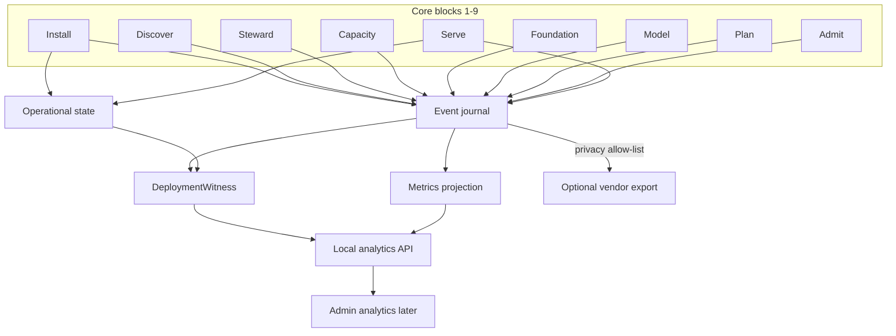

# Machi observability

**Role:** supporting. Canonical placement is Kernel Block 0 in
[ARCHITECTURE.md](ARCHITECTURE.md).

Observability is a **cross-cutting core service**. It is not a
deployment step after inference. It is not the owner of operational
state. Domains remain authoritative; events record what happened.

Machi is **not** event-sourced. Direct contracts admit, reserve, and
launch. Events are an append-only witness.

---

# 1. Four stores, kept apart

| Store | Holds | Authoritative for | Query |
|---|---|---|---|
| **Operational state** | current contracts (profile, selection, reservation, instance) | decisions and serving | by ID |
| **Event journal** | `EventRecord` append log | what happened, in order | by InstallRun, time, type |
| **Metrics** | derived counters/gauges/histograms | rates and totals | time slice + dimensions |
| **Logs** | human diagnostic text | debugging only | never admission |

Unstructured log files are not analytics. A dropped event is itself
an event (`observability.dropped`), never silent.

---

# 2. Event envelope (`EventRecord`)

Kultrun already has three overlapping records (`kernel.Event`,
`OperationalFact`, `vendor.TelemetryRecord`). Machi uses **one**
envelope. Payloads are versioned contracts inside it.

| Field | Purpose |
|---|---|
| `schema_version` | envelope version |
| `event_id` | unique |
| `event_type` | stable dotted name (`capacity.sonar.completed`) |
| `occurred_at` | UTC, time of the fact, not persist time |
| `recorded_at` | UTC persist time (allowed to differ) |
| `install_id` | this Machi installation |
| `install_run_id` | correlation for the deployment journey |
| `host_id` | stable, non-sensitive (hashed fingerprint, not hostname/IP) |
| `block_id` | `MACHI N` or `N.M` |
| `component_id` | `N.M.P` when known |
| `parent_event_id` | optional causal parent |
| `outcome` | `pass` `fail` `blocked` `info` `unresolved` |
| `duration_ms` | optional |
| `privacy` | `public_ops` `operational` `restricted` `customer_content` |
| `payload` | versioned contract; no customer content unless privacy says so and local-only |
| `error_class` | typed family, never exception body |
| `provenance` | adapter/tool/policy versions used |

**From the first milestone (M0):** `schema_version`, `event_id`,
`event_type`, `occurred_at`, `install_run_id`, `block_id`, `outcome`,
`privacy`, `payload`.

Customer content (`customer_content`) is **local-only**. It is never
exported. Inference events store **metrics and identity**, not prompt
or response text. That is a contract rule, not a sanitizer hope.

---

# 3. Schema evolution

- Envelope versions independently of payload `kind`.
- Additive optional fields are allowed.
- Meaning changes require a new payload version.
- Readers ignore unknown fields.
- Journal retains original bytes; projections may fail soft.

Do not couple analytics to Python dataclass layouts. Persist the
versioned document form (the Kultrun `to_dict` lesson).

---

# 4. Minimum event set (core journey)

Names are examples; the catalogue is owned by Kernel 0.3.

- `install.started` / `install.bound`
- `discover.completed`
- `steward.classified` / `steward.reclaim.planned` / `steward.reclaim.completed`
- `capacity.characterized` / `capacity.minimum.completed`
- `foundation.resolved` / `foundation.selected` / `foundation.verified`
- `model.funnel.completed` / `model.selected` / `model.acquired`
- `plan.created` / `plan.stale`
- `admit.completed` / `admit.rejected`
- `serve.started` / `serve.ready` / `serve.stopped` / `serve.restarted`
- `inference.completed` (purpose in payload: `request` | `readiness`)
- `witness.composed`
- `observability.dropped`

Manual override, recharacterize, and reconciliation each emit their
own types. Do not reuse `pass` to mean “interrupted.”

---

# 5. Metrics

Dimensions that must exist by Serve (M9), and should be *reserved in
the schema* from M0:

- `install_id`, `host_class` (not hostname)
- `runtime`, `executor`, `model_logical_name`
- `outcome`, `error_class`

Measures: request count, input tokens, output tokens, latency
histogram, errors, process uptime, reservation hold time, remaining
SAFE bytes (gauge), availability.

Time slices are a **projection**. Do not invent a warehouse in M0.

---

# 6. Local storage

| Kind | Shape | Crash safety | Retention default |
|---|---|---|---|
| Event journal | append files per day or per size, checksummed batches | fsync batch | 30 days operational; configurable |
| State store | one record per entity ID (Kultrun file store is acceptable v0) | write-temp-rename | until superseded |
| Metrics | derived rollups from journal, rebuildable | rebuild from journal | 90 days rollup |
| Capture/logs | process capture files | rotate (Kultrun K-99) | bounded |

v0 may keep the Kultrun one-JSON-file-per-record store (K-02). Machi
must not pretend that is a database. A later engine is DEFER, not
Block 0.

---

# 7. Correlation and identity

- **InstallRun** is minted at Install and reused across CLI processes
  (Kultrun `DeploymentRun` lesson).
- Every EventRecord carries `install_run_id`.
- Inference requests carry the same ID plus a request ID.
- `host_id` is a hash of hardware fingerprint, not a customer name.

---

# 8. Provenance

Every authorizing number names:

- which observation or probe produced it;
- which policy version interpreted it;
- whether it is SAFE, reported, or unresolved.

Witness must show provenance without opening logs.

---

# 9. Privacy and vendor export

```text
customer_content  → local only, never export, never EventRecord payload
restricted        → local Admin, not vendor
operational       → local analytics; vendor only if settings allow and sanitizer allow-list passes
public_ops        → build id, OS family, event type, outcome, byte bands
```

Default export adapter is **disabled**. Enabling settings does not
send data by itself. Export failure never blocks inference (Kultrun
analytics-failure rule).

Sanitizer is allow-list, not denylist. Paths, prompts, purpose strings
that encode customer intent, and ownership IDs that are filesystem
paths do not export.

---

# 10. Effectiveness data (future)

Event payloads for Serve should already include:

- runtime family + version, executor kind
- model logical name + quantization + context
- host class (CPU family, GPU model, VRAM band)
- latency, tokens, outcome

That is enough for later recommendation evaluation **without** a
warehouse. Fleet/enterprise aggregation is an outer system that
consumes exported `public_ops`/`operational` records.

---

# 11. Diagram F — data flow



---

# 12. What M0 must actually persist

One `EventRecord` written when the artifact starts, with
`install.started`, privacy `public_ops`, and build identity in the
payload. That is the empirical proof that observability is not a
log statement.
